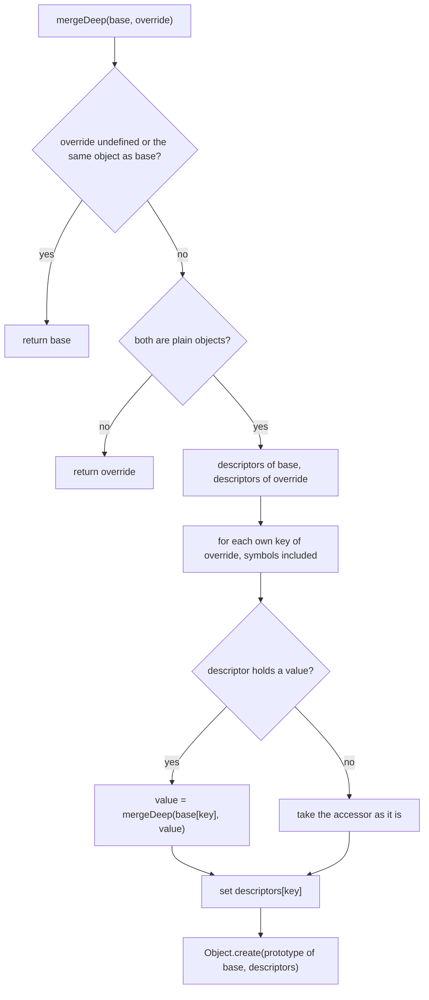

# mergeDeep.ts

## What it does

`mergeDeep(base, override)` returns `override` laid over `base`. Plain objects merge key by key; anything
else (arrays, functions, class instances, primitives, `null`) is replaced; an `undefined` override keeps
the base. It never changes its inputs.

## Why it exists

A theme given to a nested provider is a partial theme over the theme of the provider outside it. The merge
has to keep what a theme object carries beyond enumerable data, such as a helper function on `breakpoints`
that is not enumerable, and has to keep the identity of branches nobody changed. `themeInput.ts` calls it
to combine an outer theme with a given one, and `index.ts` exports it.

## The logic

A plain object is one whose prototype is `Object.prototype` or `null`. The result is built with
`Object.create` from the base's prototype and the merged descriptors, so non-enumerable members of the base
survive and members of the override replace them.

## What it guarantees

- Inputs are not changed (`mergeDeep.test.ts`).
- A branch that only one side has, or that both sides share as one object, is that same object, not a copy;
  so is the whole result when `override` is `base` (even a frozen one).
- Symbol keys and objects with a `null` prototype are kept.
- An accessor of the override is kept as an accessor, not read.
- A key whose override is `undefined` keeps the base value.

## Decisions

- Arrays are replaced, not merged: `{ list: [1, 2, 3] }` over `{ list: [4] }` gives `[4]`.
- A class instance is a value, so a `Date` replaces the object it lands on.
- Members are copied as descriptors rather than assigned, to keep non-enumerable helpers.

## Limits

- Only own members are merged; the prototype chain of the base is kept as it is and the override's is
  ignored.
