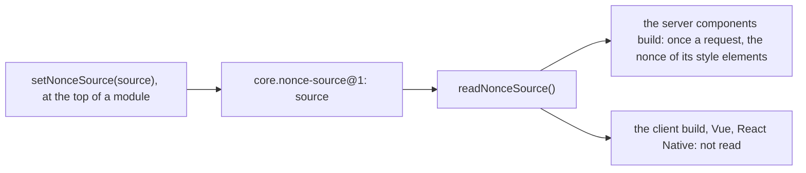

# nonceSource.ts

## What it does

`setNonceSource(source)` registers where the nonce of a request comes from, and `readNonceSource()` reads
it back. A source is a function that answers with the nonce, `undefined`, or a Promise of either. The
server components build of the React binding reads it (`createNonceReader` of its `serverContext.ts`):
in each request it calls the source once, and every style element it renders in that request carries the
answer as its `nonce`, in place of the nonce of the cache.

## Why it exists

The nonce of the engine's own cache is fixed when the engine is made, and a server of server components
renders every request with that one engine, so its style elements carried one nonce in every request. A
prop of a provider would not do: the request of a client-side navigation renders the changed segment only,
not the layout that holds the provider. A source that every request reads, wherever in the tree the first
styled component renders, does. The registry is in the core so that every binding exports the same name
(`setNonceSource` of React, Vue and React Native), and so that one registration reaches every copy of the
packages in a program (`readSharedState`).

## The data

`core.nonce-source@1` in the shared state: `{ source }`, the source registered last, or `undefined`.

## The logic

## What it guarantees

- One source for the program: the one registered last; `setNonceSource(undefined)` takes it back.
- Nothing is called here: the source is only kept.
- It touches no browser global.

## Decisions

- **One source for the program, not one for each style.** A nonce belongs to the request, not to a style:
  every style of a page needs the same one.
- **The name `setNonceSource`**: a function that sets a value of the program takes `set`, and what it sets
  is where the nonce comes from, not a nonce (the naming rules: a verb first, and the name says what it
  does).
- **Nothing outside the server components build reads it.** The client build has no store of a request
  in a classic server render (`React.cache` keeps nothing there), and a cache made for each request
  (`createCache({ key, nonce })` under a `CacheProvider`, or the `nonce` of `extractPageStyles`) already
  gives such a render the nonce of its request. Vue and React Native render no server components.

## Limits

- A source that throws, or a Promise that rejects, fails the render of the request, as any error of a
  server component does.
