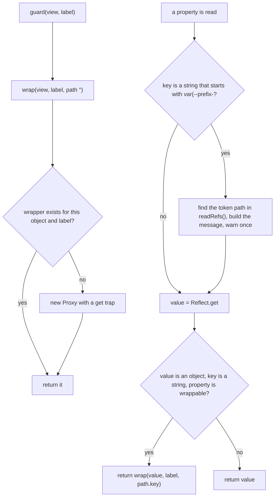

# referenceKeys.ts

## What it does

`createReferenceGuard(prefix, readRefs, warn)` returns a function `(view, label) => object` that wraps a
theme view in a Proxy. When a style function reads any part of the wrapped view with a key that is a token
reference of this engine (a string that starts with `var(--<prefix>-`), the guard calls `warn` with a
message that names the label, the path, the key and, when it can find it, the token.

## Why it exists

In a style function a token is a reference (`var(--ds-layout-margin)`), not its value, so a lookup such as
`theme.space[theme.layout.margin]` reads `theme.space['var(--ds-layout-margin)']` and gives `undefined`
with no error. The guard makes that mistake visible in development. `createEngine.ts` is the only user: its
`createEngineChecks` builds the guard when the development checks are on, and passes the view as it is when
they are off.

## The logic



`findReferencePath` walks the reference tree of the base theme and returns the dotted path of the leaf that
equals the key, which is how the message names `layout.margin`. The call to `warn` passes the message as
both the dedup key and the text, so the same message is shown once.

## The data

`wrappers` is a `WeakMap<object, Map<label, wrapper>>`. A message looks like this (copied from
`referenceKeys.test.ts`):

```
[rk] A style function of "Box" reads theme.space[var(--rk-layout-margin)]: var(--rk-layout-margin) is a
token reference, not the value of the token, so the lookup gives undefined. Give "layout.margin" a raw
mode (modes: { 'layout.margin': 'raw' }), or read the real value from useTheme().
```

## What it guarantees

- A view read twice gives the same wrapper for one label, so identity comparisons keep working.
- A property that is neither configurable nor writable is returned as it is, because a Proxy `get` must
  give the real value for such a property (`isWrappable`).
- With no label the message omits the owner; for a key that is no token it says `the token` and
  `'<path>'`.
- Without the development checks nothing is wrapped (`referenceKeys.test.ts`, "costs nothing").

## Decisions

- Each warning is deduplicated by its text, which names the label, so two components that make the same
  mistake each warn once.
- The guard fixes the lookup with advice to give the token a raw mode, or to read from `useTheme()`; it
  does not change the result of the lookup, which stays `undefined`.

## Limits

- Only reads through the Proxy are seen; a view copied out first (`{ ...theme }`) is no longer guarded.
