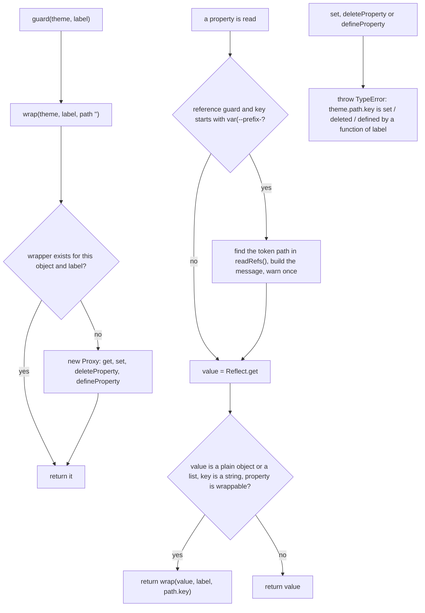

# referenceKeys.ts

## What it does

The development guard of the theme that a function of app code is given. It wraps a theme in a Proxy, at
every level, so that:

- a write (`=`), a `delete` or an `Object.defineProperty` of any key, at the top level or below, throws a
  `TypeError` that names the dotted path, the function's label and what to do instead;
- with `createReferenceGuard(prefix, readRefs, warn)`, a read with a key that is a token reference of this
  engine (a string that starts with `var(--<prefix>-`) warns through `warn`, naming the label, the path,
  the key and, when it can find it, the token.

`createThemeGuard(head)` is the guard with writes only, for a binding whose themes hold real values (React
Native); `head` is what its errors start with. Both return a `ThemeGuard`, `(theme, label) => theme`.

## Why it exists

The theme a function gets is one object for every render and, on a server, for every request of the
process: the base theme, a view the engine keeps, or the theme of a provider above. A write into it from a
style function, a `keyframes` or `Global` function, a sheet or a provider function leaks into every later
render and request, with no error. The guard makes it an error in development.

In a style function a token is a reference (`var(--ds-layout-margin)`), not its value, so a lookup such as
`theme.space[theme.layout.margin]` reads `theme.space['var(--ds-layout-margin)']` and gives `undefined` with
no error. The reference guard makes that visible too.

`createEngine.ts` builds the reference guard when the development checks are on (`createEngineChecks`) and
passes the theme as it is when they are off; the React Native binding builds `createThemeGuard` once
(`devGuard.ts`) and uses it in development only.

## The logic



`findReferencePath` walks the reference tree of the base theme and returns the dotted path of the leaf that
equals the key, which is how the read message names `layout.margin`. The call to `warn` passes the message as
both the dedup key and the text, so the same message is shown once.

## The data

`wrappers` is a `WeakMap<object, Map<label, wrapper>>`, one for each guard: a wrapper is made once for each
object and label and kept while the object lives. Messages, copied from the tests:

```
[rk] A style function of "Box" reads theme.space[var(--rk-layout-margin)]: var(--rk-layout-margin) is a
token reference, not the value of the token, so the lookup gives undefined. Give "layout.margin" a raw
mode (modes: { 'layout.margin': 'raw' }), or read the real value from useTheme().
```

```
[g] theme.mode is set by a function of "Box". The theme is one object, shared by every render and every
request, so a change to it reaches all of them: never change it. Build a new object instead, such as
{ ...theme, mode: value }.
```

## What it guarantees

- A part read twice through the same label is the same wrapper, so identity comparisons and caches keyed by
  a member (`theme.breakpoints`) keep working across renders.
- A property that is neither configurable nor writable is returned as it is, because a Proxy `get` must
  give the real value for such a property (`isWrappable`); such a part is not guarded, and needs no guard.
- A value that is not a plain object or a list (a function, a `Date`, a `Map`, a class instance) is returned
  as it is, so its methods run on the real object.
- A read gives the value the theme holds; a write never reaches the theme.
- With no label the messages omit the owner; for a key that is no token the read message says `the token`
  and `'<path>'`.
- Without the development checks nothing is wrapped (`referenceKeys.test.ts`, "costs nothing").

## Decisions

- Each read warning is deduplicated by its text, which names the label, so two components that make the
  same mistake each warn once. A write throws every time: it is a bug, not a hint.
- A wrapper is kept for each object and label, not for each object: the label is part of what the messages
  say. The cost, in development only: one Proxy for each part of the theme that each label reads, kept while
  that part lives, and a cache keyed by a member made once for each label instead of once for all.
- The guard fixes the lookup with advice to give the token a raw mode, or to read from `useTheme()`; it
  does not change the result of the lookup, which stays `undefined`.
- Before 0.7.0 the guard had a `get` trap only and wrapped any object; it now wraps plain objects and lists
  only, so a `Date` or a `Map` in a theme is read with its own methods in development as in production.

## Limits

- Only what goes through the Proxy is seen: a part copied out first (`{ ...theme.palette }`) is a new
  object, which the function may change, and a part of the theme kept elsewhere is not guarded.
- A part reached by two paths keeps the path it was first reached by, in the messages.
- A write into a function, a `Date` or a `Map` of the theme is not seen.
