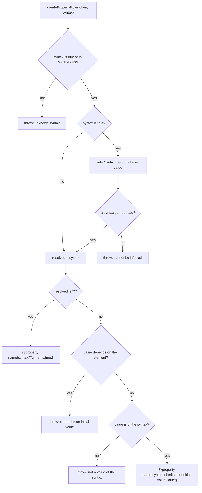

# registered.ts

## What it does

Writes the `@property` rule of a token that a theme registers: a custom property with a type, so that a
`transition` on it can animate a theme switch. It takes a token (its variable name, dotted path, base value
and declared text) and a syntax, or `true` to infer the syntax from the base value, and returns the rule
text. It throws a `TypeError` that names the path when the syntax is unknown, cannot be inferred, or the
base value cannot be the initial value of that syntax.

## Why it exists

An untyped custom property cannot be interpolated, so a theme class that changes `--css-palette-primary`
switches colors with no transition. A registered property has a syntax and an initial value, and the
browser can animate it. A rule that the browser would drop silently (an initial value that is not of the
syntax, or that depends on the element) is a bug that shows nowhere, so the checks are here and throw at
the point where the theme is made. It is its own file because the matching of values by syntax is large
and only `tokens.ts` calls it: `createTokens` builds `registrations` with `createPropertyRule`.

## The logic

The syntax is checked first against the list. `true` goes to `inferSyntax`, which reads the source value:
a number is a `<length>` when its top-level key is a length key and a `<number>` otherwise; a string is
tried as a length, a percentage, a time, an angle, a color and a number, in that order. `*` returns at once,
with no initial value. Any other syntax passes `assertInitialValue`: first the value must not depend on the
element (`var()`, `env()`, `attr()`, `currentcolor`, or a font or viewport relative unit such as `em`,
`rem`, `vw`), then it must match the syntax. A math function (`calc`, `min`, `max`, `clamp`) is taken on
trust for every syntax but `<color>`. A bare keyword counts as a `<color>`.

## The data

`RegisteredToken` is what `tokens.ts` hands in: `name` (`--css-palette-primary`), `path` (`palette.primary`,
for messages), `source` (the value in the base theme, a number stays a number), `value` (the text a theme
class declares, a length in px) and `isLength` (the number sits under a length key). The result is a string
such as `@property --u-space-1{syntax:"<length-percentage>";inherits:true;initial-value:4px;}` (the form
asserted in `tokens.registered.test.ts`).

## What it guarantees

- `inherits` is always `true`: a variable set on a theme wrapper must reach what is inside it.
- The initial value is the base theme's declared `value`, never a value that depends on the element.
- `*` never gets an initial value.
- It writes nothing and holds no state: the same token and syntax give the same text.
- Every error is a `TypeError` that starts with `registered:` and names the dotted path.

## Decisions

- Relative units cannot be initial values, because the browser rejects them in `@property`; the test
  `does not take an absolute unit, a hex color or a number with an exponent for a relative unit` shows the
  pattern does not confuse `1e3` or `#1em` with a relative unit.
- `inherits` is fixed to `true` instead of an option (comment on `createPropertyRule`).
- A math function is not checked against its syntax, only trusted; a color function is matched by name and
  a `(...)` body, not parsed.
- The reason a keyword is accepted as a `<color>` rather than checked against the list of color names is
  not recorded in the code.

## Limits

- Hex colors of 5 or 7 digits, unclosed or unknown color functions, and a color function over two lines
  are not colors (`tokens.registered.test.ts`, `does not take a hex color of 5 or 7 digits ...`).
- A math function whose result is of the wrong type is not caught.
- The color function pattern accepts any text between the parentheses, so `rgb(nonsense)` passes.
- A test in a browser (`registered.browser.test.ts`) proves what the browser does with the rule; this file
  only checks the text.
