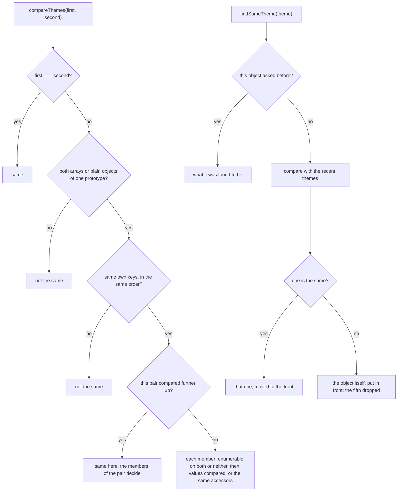

# sameTheme.ts

## What it does

`isSameTheme(first, second)` tells whether two themes have the same contents, and `createThemeMemo()`
makes the function that gives, for a theme object, the first object seen with the same contents. The
engine keeps its root rules and its views by theme object; with these, a theme that is a new object with
the contents of one seen before (a provider whose theme is made in each render, `{ ...base }`) finds the
work done for that one.

## Why it exists

A server renders each request from nothing, so an app's provider that makes its theme in the render
(`useMemo` does not survive from one request to the next) gives the engine a new object every time. The
engine cached the declarations of a root theme (`declareRoot`), the view of a theme (`createThemeView`)
and the merge of a provider's theme over the one above (`mergeTheme`) by object, so every render declared
every token again, made the view again and compared it with the recent ones: on a design system's home
page about half of the render's time and three quarters of its allocation. Importers: `createEngine.ts`
(the memo of an engine family) and `themeInput.ts` (the merges of `mergeTheme`).

## The data

- What is compared: arrays and plain objects (prototype `Object.prototype`, `null`, or an array's), walked
  member by member; everything else (a string, a number, a function, a class instance, a date) is the same
  only when it is the same value (`===`).
- `ComparedPairs`: the pairs of containers being compared, from the outermost in, as two parallel lists.
  The depth of a theme is small, so a lookup in them is a short scan, and nothing is allocated for a pair
  but its place in the lists.
- The memo: a `WeakMap` from each object asked about to the object it was found to be (the first seen with
  its contents), and the last `RECENT_THEMES` (4) themes of distinct contents, the one used last first.

## The logic

## What it guarantees

- What the engine makes of a theme depends on the members it reads: the enumerable own keys of plain
  objects and arrays in their order (the order of the declarations, and so the name of a root rule and of
  a theme class), their values, and under a raw key the object as it is (a view hands it to a style
  function whole). Two themes that `isSameTheme` calls the same give the same declarations and views that
  `isSameView` calls the same: the keys are compared in order, non-enumerable members and symbols too,
  and the enumerability of each member, so the rule is stricter than what the output needs, never looser.
- A function, a class instance or any other object that is not a plain object or an array is the same
  only as itself: a theme with another function under a raw key is another theme.
- A theme that refers to itself does not loop: a pair met again on the way down is taken as the same,
  and the comparison of its members decides.
- An object is compared with the recent themes once; asked again, it gets what it was found to be.

## Decisions

- **Contents, compared, rather than a hash or a fingerprint of the theme.** A theme holds functions and
  class instances under raw keys, which no text form tells apart, and may hold cycles. A comparison with
  identity first stops at the first difference.
- **Order of keys is part of the contents.** Two themes with the same members in another order declare
  their variables in another order, so their root rules have other names: they are not the same.
- **Writable and configurable are not compared.** No output depends on them, and a spread copy of a frozen
  theme differs from it only there.
- **Four recent themes.** An app has one or two whole themes (light and dark) and a few nested ones; a
  theme of new contents is compared with at most four before it is taken as new.
- Measured on the theme of the evidence (159 tokens) and the large theme of `bench/src/themes.ts` (281),
  in Node on a laptop, the minimum of 15 runs: a shallow copy is found the same in 4.8 and 2.2 us, a deep
  copy in 111 and 65 us; a copy with the last palette value changed is found different in 86 and 25 us,
  one with the first key changed in 2.4 and 1.0 us. What a new object cost an engine before
  (`declareRoot` and `createThemeView` of `{ ...theme }`) was 443 and 839 us; it is 5.2 and 3.6 us now.

## Limits

- It relies on what the engine assumes already: a theme object is not changed after it is used. A theme
  changed in place after it was seen is still taken for what it was.
- A theme of new contents costs up to four comparisons before its own work; each stops at the first
  difference, so two themes that differ only near the end of their keys cost the most (86 us for the
  theme of the evidence).
- The four recent themes are kept for the life of the memo: an engine family, or the module for the merges
  of `mergeTheme` (there, for as long as the theme above them lives).
