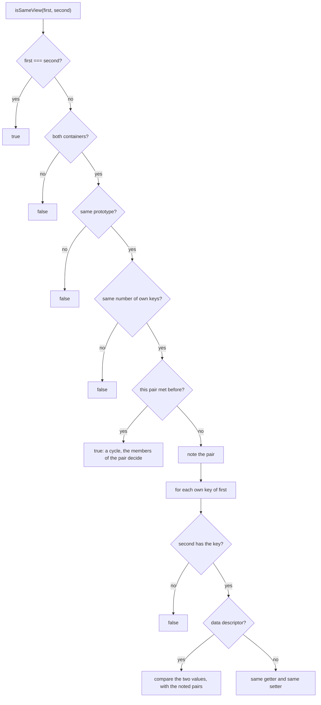

# sameView.ts

## What it does

`isSameView(first, second)` tells whether two theme views hold the same thing. Arrays and plain objects
are the same when they have the same prototype and the same own members (enumerable or not, string or
symbol keys), each the same in turn. Anything else, a function or a class instance, is the same only by
identity. A view that refers to itself is compared once around the cycle.

## Why it exists

A theme view is the shape of a theme with `var(--name)` references in place of the variable tokens. Two
different theme objects that differ only in the values of their variables make views that are equal in
content but not in identity. A function style that reads the view gives a class name that depends on what
it returns, and objects of equal content would still be told apart if the engine compared by identity.
`createEngine.ts` keeps the last few views (`recentViews`, 8) and uses `isSameView` to hand back the earlier
one, so that two themes that differ only in variable values share one view, one base class and one rule
(`createEngine.base.test.ts`, `shares one base class and one rule between views that differ only in token
values`). It is its own file because it is a pure comparison with no engine state; only `createEngine.ts`
imports it.

## The logic

A container is an array or an object whose prototype is `Object.prototype` or `null`. The keys come from
`Reflect.ownKeys`, so non-enumerable and symbol keys count. A data property recurses into its value; an
accessor property is the same only when both its `get` and its `set` are the same functions.

`isSameView` starts a comparison with an empty record of pairs (`PendingPairs`: for each container of the
first view, the containers of the second it was compared with). A pair that is met again is taken as the
same: either it is being compared further up (a cycle), and its other members decide, or it was compared
before and was the same, since a difference anywhere ends the whole comparison with `false` at once. So a
pair is never taken off the record.

## What it guarantees

- It never calls a getter: it reads descriptors, so a view with an accessor is compared without running it.
- It does not change either argument.
- A function, a class instance, a `Date` and the like are compared by identity.
- It returns for a view with a cycle: a pair of containers is compared once (`compares a view that refers to
  itself once around the cycle, and returns`), and a cycle whose members differ further round is told apart
  (`tells apart a cycle whose members differ further round`).
- A view with no cycle gives the answer it gave before the record of pairs: a pair is met again only through a
  cycle, or as an object that two places share, whose comparison was already `true`.

## Decisions

- Non-enumerable members are compared: `themeView.test.ts` (`compares the members that are not
  enumerable, and the accessors, of a raw value`) and `sameView.test.ts` show the case. The reason for choosing own keys over
  `Object.keys` is that a raw value of the theme (kept as is, such as `breakpoints`) can hold such members.
- A class instance is by identity, never by structure, because its behaviour is not in its own keys.
- The record is of pairs, not of the objects of one view: an object of the first view that is met with
  another object of the second (`compares one object of the first view with two of the second`) is compared
  again, so a cycle that holds different values further round is not taken as the same.

## Limits

- The recursion follows the depth of a view: a view nested deeper than the stack allows (thousands of levels)
  throws a `RangeError`, as any deep recursion does. A theme is not that deep.
- Each comparison makes a `Map` for the record of pairs, and one `Set` for each container compared.
