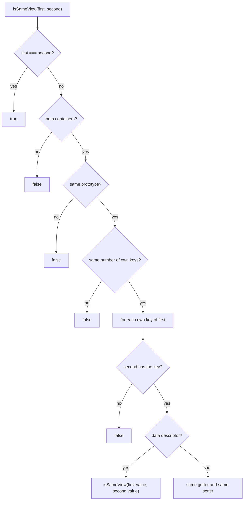

# sameView.ts

## What it does

`isSameView(first, second)` tells whether two theme views hold the same thing. Arrays and plain objects
are the same when they have the same prototype and the same own members (enumerable or not, string or
symbol keys), each the same in turn. Anything else, a function or a class instance, is the same only by
identity.

## Why it exists

A theme view is the shape of a theme with `var(--name)` references in place of the variable tokens. Two
different theme objects that differ only in the values of their variables make views that are equal in
content but not in identity. A function style that reads the view gives a class name that depends on what
it returns, and objects of equal content would still be told apart if the engine compared by identity.
`createEngine.ts` keeps the last few views (`recentViews`, 8) and uses `isSameView` to hand back the earlier
one, so that two themes that differ only in variable values share one view, one base class and one rule
(`createEngine.base.test.ts`, `shares one base class and one rule between views that differ only in token
values`). It is its own file because it is a pure comparison with no engine state; only `createEngine.ts`
imports it.

## The logic

A container is an array or an object whose prototype is `Object.prototype` or `null`. The keys come from
`Reflect.ownKeys`, so non-enumerable and symbol keys count. A data property recurses into its value; an
accessor property is the same only when both its `get` and its `set` are the same functions.

## What it guarantees

- It never calls a getter: it reads descriptors, so a view with an accessor is compared without running it.
- It does not change either argument.
- A function, a class instance, a `Date` and the like are compared by identity.
- A cycle is not followed with a guard: see Limits.

## Decisions

- Non-enumerable members are compared: `themeView.test.ts` (`compares the members that are not
  enumerable, and the accessors, of a raw value`) shows the case. The reason for choosing own keys over
  `Object.keys` is that a raw value of the theme (kept as is, such as `breakpoints`) can hold such members.
- A class instance is by identity, never by structure, because its behaviour is not in its own keys.

## Limits

- There is no direct test of this file: it is covered through `themeView.test.ts` and
  `createEngine.base.test.ts`.
- A view that refers to itself would recurse without end; no guard exists in the code, and no test covers it.
