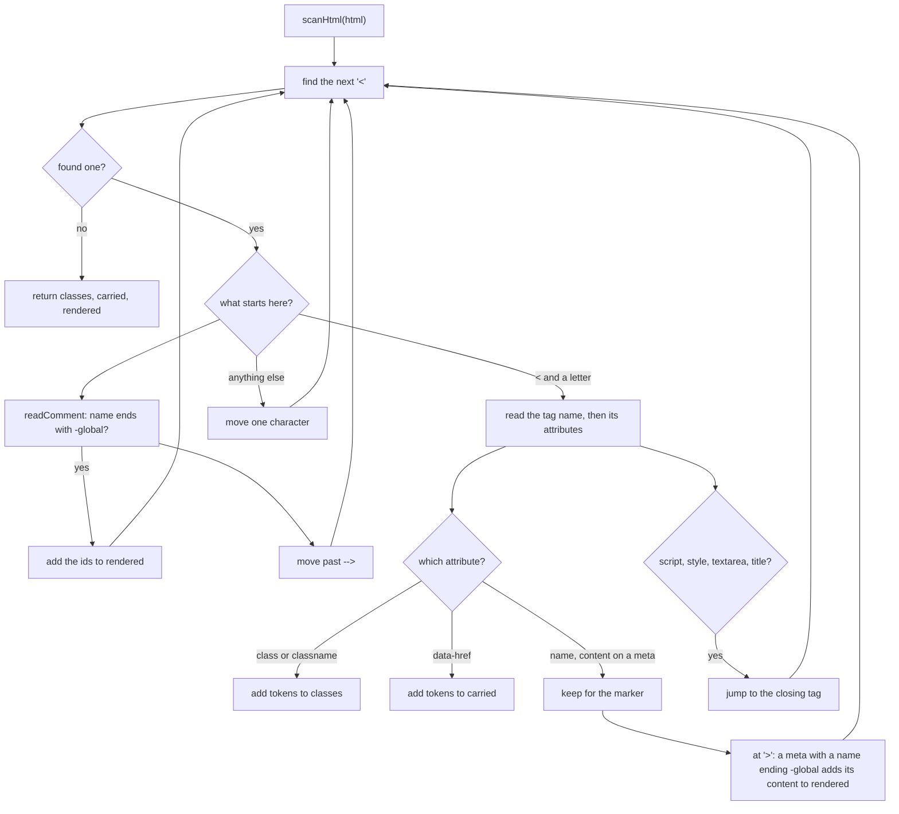

# scanHtml.ts

## What it does

`scanHtml(html)` reads a finished HTML document in one forward pass and returns three sets of tokens:
the classes of every `class` or `className` attribute, the keys of the style elements the document already
carries (`data-href`), and the ids named by the markers of global rules. `createGlobalMarker(prefix, sets)`
is the other half: it builds the marker that a server render writes so that the scan can read it back.

## Why it exists

`extractPageStyles` (in `extractStyles.ts`) writes the CSS of one page, and it needs to know which classes
the markup uses, which style elements are already in it, and which sets of global rules the page rendered.
A `Global` component that renders no style element leaves only a marker: a `<meta name="<prefix>-global"
content="ids">` for React or a comment `<!--<prefix>-global ids-->` for Vue. Reading all that with patterns
risks backtracking on hostile input, so this is a scanner with indexes. It is its own file because the
scan knows only HTML text; `extractStyles.ts` imports `scanHtml`, and `internal.ts` re-exports
`createGlobalMarker` for the bindings (React `styleElements.ts`, Vue `Global.ts`).

## The logic

Attribute names are lower-cased. A value is quoted with `'` or `"` or bare (up to whitespace or `>`). The
scan moves forward only; an unclosed comment, tag, value or raw text element ends at the end of the
document. A class name in any other attribute is not read.

## The data

`HtmlTokens` has `classes`, `carried` and `rendered`, each a `Set<string>`. `GlobalMarker` is
`{ name, ids }`: `name` is `<prefix>-global` and `ids` the ids joined by a space. From the test:
`createGlobalMarker('u', sets)` gives `{ name: 'u-global', ids: 'u-global-a u-global-c' }`, and
`scanHtml('<!--u-global u-global-a u-global-c-->').rendered` holds both ids.

## What it guarantees

- Time is linear in the length of the document, and no regular expression backtracks (the test
  `takes linear time on a large document, and on input made to defeat backtracking`).
- Comments other than a marker and the content of `script`, `style`, `textarea` and `title` never add a
  class.
- `createGlobalMarker` returns `undefined` when no set has a rule, so a page with no global rules gets no
  marker.
- It reads no browser global; it is plain string work.

## Decisions

- Both `class` and `className` are read, in any case, so markup from either binding works.
- A marker is recognised by a name that ends in `-global`, whatever the prefix, for a `<meta>` and for the
  first word of a comment. A meta with another name, or a `name` and `content` on another element, adds
  nothing.
- The scanner was chosen over a pattern; the doc comment says the pass "moves forward only" and has "no
  pattern to backtrack".
- Written for speed, with the same tokens (issue 10): a tag or attribute name is compared with the names
  the scan reads in place, its ASCII capitals lowered (`findWord`), instead of being cut out and lowered
  (no other character lowers to a letter of those names); a class value read before adds nothing again (a
  `Set` of the values of the scan, which goes with it); a value of printable ASCII is cut at its spaces,
  and any other value is split on `\s+` as before. The scan of the tree of 500 took 158 us before and
  98 us after (host), the CSS of that page 215 and 103 us.

## Limits

- A class name written in an attribute other than `class` or `className` is not found.
- It is not an HTML parser: no entity decoding, no `<template>` or `<svg>` rules; the tests cover bare
  angle brackets, doctype and closing tags, which are not taken for tags.
