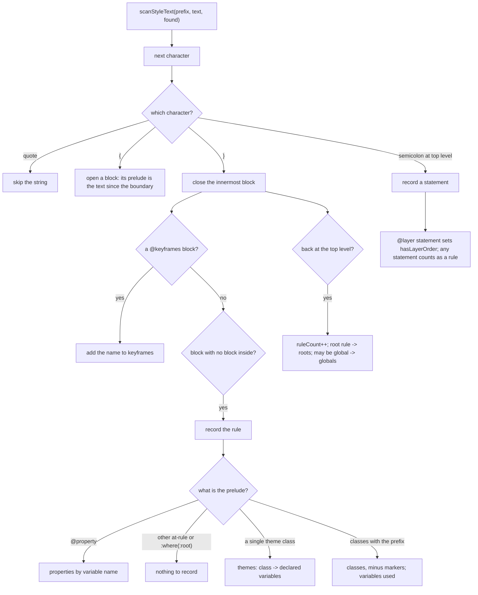

# scanStyleText.ts

## What it does

`scanStyleText(prefix, text, found?)` reads the CSS text of an engine's style element, which is compact
and has no comments, in one pass, and adds what it holds to a `StyleFindings`: the layer order statement,
the classes that rules name, each theme class with the variables it declares, the `@property` rules,
the `@keyframes` names, the variables the rules use, the number of top-level rules, the top-level rules
that may be global, and the places of the rules of a root theme. `createEmptyFindings()` makes the empty
record.

## Why it exists

A cache that starts in a browser, or hydrates a server-rendered page, finds style elements already there.
It must know what they hold so that it does not write a rule twice and so that its bookkeeping (which
classes exist, which variables are used, which themes declared what) matches the page. This file turns the
text into that picture. `cache.ts` calls it on the text of each style element it adopts. It is its own
file because it reads text only; it uses `scanVariables` from `variables.ts` for the references in a body.

## The logic

A rule is recorded only when it holds no block of its own, so a rule inside `@media` or a layer is read at
its innermost level. Strings are skipped so that braces or semicolons inside them are not taken for syntax.

## The data

`StyleFindings`: `hasLayerOrder`, `classes: Set`, `themes: Map<class, Set<variable>>`,
`properties: Map<variable, rule text>`, `keyframes: Set`, `variables: Set`, `ruleCount`,
`globals: [index, text][]` and `roots: number[]` (indexes among the top-level rules). A theme class is a
prelude that is exactly one class starting with `<prefix>-theme-`; its variables are the custom properties
the body declares. The markers `<prefix>-boundary`, `<prefix>-scheme-light` and `<prefix>-scheme-dark`, and
theme classes, are not put in `classes`.

## What it guarantees

- One pass over the text, in order, with no pattern that backtracks (the test `reads a large text in one
  pass`).
- It adds to the findings it is given, so several style elements can be read into one record.
- It survives text that ends inside a block or a string (`adds to the findings it is given, and survives
  text that ends inside a block or a string`).
- A root theme, `:where(:root){...}` in the `<prefix>-theme` layer or in none, is listed in `roots` and is
  never a global rule.
- A layer statement, `@property`, `@keyframes` and a rule of a class `.<prefix>-...` are not global rules.

## Decisions

- Top-level rules are counted so that the cache can compare with the browser's own rule count, which is
  the number "when the browser kept them all" (the doc comment of `ruleCount`).
- A rule with more in its selector than one theme class is not a theme rule (`does not take a rule with
  more in its selector for a theme rule`).
- The text is assumed to be what an engine wrote: compact, no comments. The reason for not handling
  comments is not recorded in the code, but the doc comment states the assumption.

## Limits

- CSS comments are not skipped; text with comments is outside what it reads.
- `ROOT_SELECTOR` (`:where(:root)`) is defined here and again in `theme.ts`; the two must stay equal.
- A class name with an uppercase letter ends at that letter, since only lowercase letters, digits, `-` and
  `_` are name characters.
