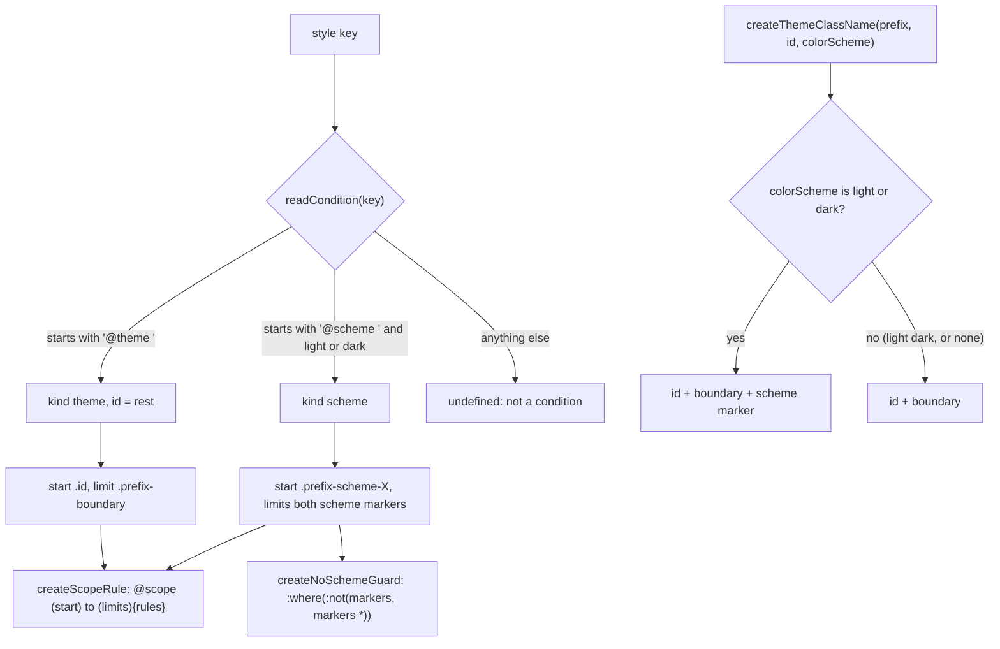

# scope.ts

## What it does

Holds the vocabulary of conditional styles: the keys `@theme <themeClass>` and `@scheme dark|light`, the
marker classes `<prefix>-boundary` and `<prefix>-scheme-<scheme>`, the class string of a theme, the
`@scope` rule that limits a style to the elements below a start and above a limit, and the guard selector
for "no scheme marker anywhere above". It has no state; each function is a string builder or a parser of a
key.

## Why it exists

A style can say "when the nearest theme is X" or "when the nearest color scheme is dark", even when themes
nest. That needs a limit: the rule must stop at the next theme boundary. The names of the markers, the
format of the keys and the shape of the `@scope` rule must be the same in the writer (`serialize.ts`), in
the cache and in the bindings that put the classes on elements. They live here so that there is one
definition. Importers: `serialize.ts` (compiles a condition key), `createEngine.ts`, `globalStyles.ts`,
`keyframes.ts` and `findInvalidValues.ts`, and `index.ts` re-exports for the bindings.

## The logic

`createThemeKey` and `createSchemeKey` make the keys; `readCondition` reads them back and returns
`undefined` for any other key, including `@scheme blue` and `@themes x`. The compiler in `serialize.ts` uses
the start and limit above. For a scheme condition it writes the scoped rule and, as well, a
`@media (prefers-color-scheme: ...)` rule whose selector ends with the guard, so that the system preference
decides where no marker is present.

## The data

`Condition` is `{ kind: 'theme', id }` or `{ kind: 'scheme', scheme }`. `Scoping` is `{ prefix, hasScope }`
and `DEFAULT_SCOPING` is `{ prefix: 'css', hasScope: true }`. Examples from `scope.test.ts`:
`createThemeClassName('u', 'u-theme-a', 'dark')` is `'u-theme-a u-boundary u-scheme-dark'`;
`createScopeRule('.a', '.b', ['.c{x:y;}', '.d{x:z;}'])` is `'@scope (.a) to (.b){.c{x:y;}.d{x:z;}}'`;
`createNoSchemeGuard('u')` is
`:where(:not(.u-scheme-light,.u-scheme-dark,.u-scheme-light *,.u-scheme-dark *))`.

## What it guarantees

- A theme class string always carries the boundary marker, so any themed element can be a scope limit.
- The scheme marker is added only for `light` or `dark`; `light dark` and no scheme add none.
- The guard has specificity 0 (it is inside `:where`).
- Nothing touches a browser global.

## Decisions

- A limit is written relative to the scope root, so the root is never cut by its own marker; the comment on
  `createScopeRule` says this was checked in a browser (`to (.x)` and `to (:scope .x)` agree).
- `hasScope` exists so that a cache can fall back to a plain descendant selector; the comment in
  `Scoping` notes that without it nesting is wrong for nested themes.
- The reason the default prefix is `css` is not recorded in the code.

## Limits

- Only `light` and `dark` are scheme names; any other name is not a condition.
- The plain descendant form (without `hasScope`) does not stop at a limit; `serialize.ts` states this.
