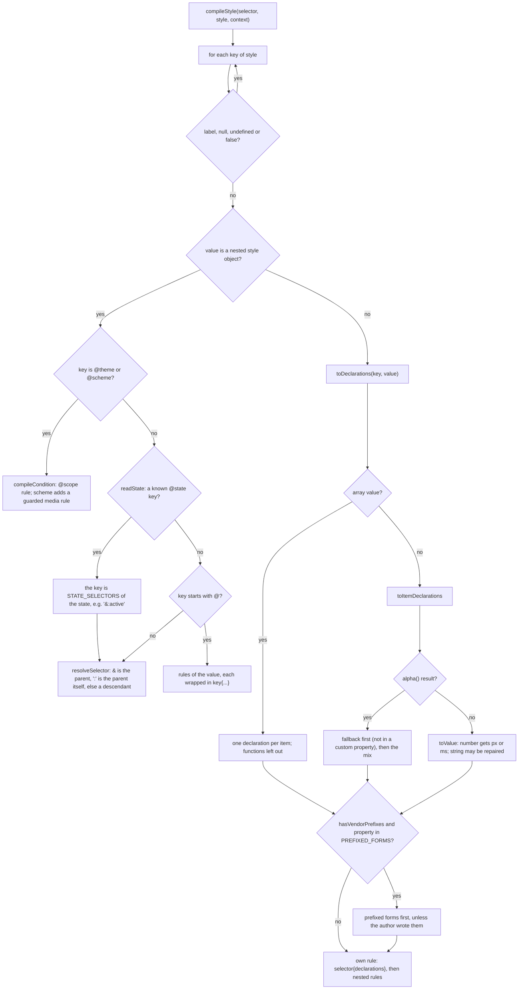

# serialize.ts

## What it does

Turns a style object into flat CSS rules and merges style objects. `compileRules` and `compileStyleRules`
take a selector and a style and return an array of rule strings: declarations in camelCase or as written,
nested selectors with `&`, at-rules, `@theme` and `@scheme` conditions, `@state` keys, `alpha()` values with a fallback,
fallback lists, vendor-prefixed forms and, when asked, a repair of string forms of token maths.
`mergeStyles` merges style objects left to right. `joinLabels`, `readLabel` and `toSelectorText` are small
helpers around labels and selector lists.

## Why it exists

Every other part of the engine ends in text that goes into a style sheet: a component's class, a sheet
entry, global rules, keyframes. One serializer makes the text the same everywhere, so that equal styles get
equal text and so equal class names. It is large because the rules of writing a value are many (units, time,
lists, color fallbacks, conditions) and they must be in one place. Importers: `cache.ts` (class rules and
entries), `createEngine.ts` (`joinLabels`), `css.ts`, `globalStyles.ts`, `keyframes.ts`,
`findInvalidValues.ts`, `sheetEntry.ts` and `templateStyle.ts` (the `StyleObject` type and `mergeStyles`),
and `umberCache.ts` (a type).

## The logic

`toValue` decides a number: a time property gets `ms` (0 included), a length gets `px` unless it is 0, a
custom property or a unitless property (`UNITLESS`). With `hasValueRepair`, a string that holds `var(` and
is not a custom property goes through `repairValue`: `var(--x)1F` becomes the `alpha()` text, `-var(--x)`
becomes what `negate()` writes, and `var(--x)px` becomes the bare reference when the token has that unit,
a `calc(ref * 1px)` when it is a plain number, else is left as it is and reported.

A state key (`state.ts`) is read before the at-rule test: its selector takes the place of the key, and the
rest is the path of a selector key, so `@state pressed` and `&:active` give the same rules, and so the same
class name. A `@state` key with another name is an at-rule, as before.

`mergeStyles` first resolves `web` and `native` parts (the `web` part is merged over the rest, `native` is
dropped), skips `undefined`, `null` and `false`, deletes the earlier key so a later key moves to the end,
merges nested objects the same way, and joins two labels with `joinLabels`.

## The data

`StyleObject` maps a key to a `StyleValue`: string, number, `AlphaColor`, nothing, a list, or a nested
`StyleObject`. `CompileContext` has `hasColorFallbacks`, `hasValueRepair`, `scoping`, and the optional
`readValue`, `report` and `hasVendorPrefixes`. `joinLabels('Typography', 'Link')` is `Typography-Link`;
a label already a whole run of the earlier one is not written again.

## What it guarantees

- A state key gives exactly the rules of its selector key, in the place it is written (`state.test.ts`).
- Output is deterministic: key order is the order of the object, so equal objects give equal text.
- A function value is never written as CSS; it is left out.
- A custom property value is never repaired and never gets an alpha fallback (it would always win there).
- Nothing is written for a rule with no declarations: the own rule is omitted and an empty condition gives
  no rule.
- `mergeStyles` does not change its inputs, and a key whose value declares nothing leaves an earlier value.
- No browser global is touched.

## Decisions

- `compileRules` writes no vendor prefixes and does no unit repair beyond the flag; `compileStyleRules`
  takes the whole `context` (comment on `compileStyleRules`).
- A prefixed form is written before the standard declaration in the same rule, and not at all when the
  author declared that form under either spelling (`vendorPrefixes.test.ts`).
- A state key is translated here, at the one place a nested key is read, rather than in `state()`: a style
  holds the same key on every platform, and only the web writes it as a selector. `mergeStyles` does not
  translate it, so a style with both `@state pressed` and `&:active` keeps two keys and writes two rules for
  the same selector, the later one winning in the cascade.
- Labels are joined, not replaced, so a merged style names every style that has one.
- Written for speed, with the same output (issue 10): a style's keys are read with `Object.keys` and
  each value by its key, not as `Object.entries` pairs; `mergeStyles` deletes a key only when it is
  there to move to the end (a delete of a missing key changes nothing, and slows the object down); a
  nested key and its parent with no comma are joined as one part each, without splitting them into
  lists. Together they took a hit of a small style from 1.28 to 0.93 us, of the large one from 13.3 to
  7.7 us, and a new small style from 3.1 to 1.8 us (host, one process).
- The reason the unit list `REPAIR_UNITS` is the one it is (for example, why `in` and `pc` are present)
  is not recorded in the code beyond "a unit a `calc()` can multiply a number by".

## Limits

- A `var()` without a close parenthesis stops the repair and keeps the rest as it is
  (`leaves alone ... a reference that is not closed`).
- A unit that goes on (`var(--x)pxa`) or a length unit after a time reference is left alone.
- Selector splitting counts only `()` and `[]`; a comma inside a string in a selector is not protected.
- The property name cache `propertyNames` is module state that only grows.
