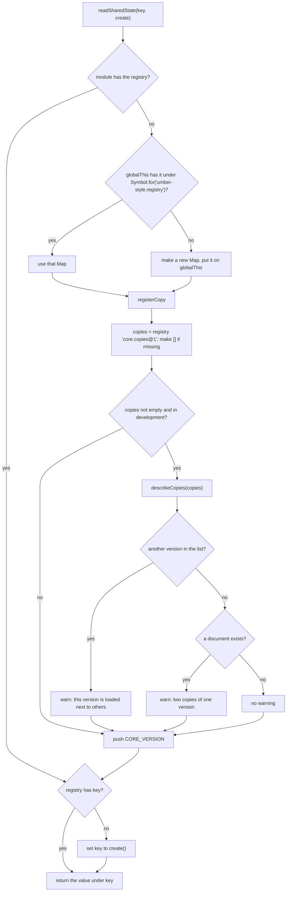

# sharedState.ts

## What it does

Gives every copy of the packages loaded in one program one shared `Map` on `globalThis`, and exposes
`readSharedState(key, create)`: the value stored under `key`, made by `create` for the first copy that
asks. It also exports `CORE_VERSION`, the version of this copy, which each copy records when it first reads
the registry. In development it warns when a second copy registers.

## Why it exists

A program can load the core twice: a bundler that bundles one package and leaves another external, or two
versions in one `node_modules` tree. Module-level state is then per copy, so a name registered by one copy
(a cache, a keyframes name, a provider context) is invisible to the other. Putting such state in a registry
on `globalThis` keeps it common. The state that must be common is read here by `cacheRegistry.ts`,
`keyframes.ts`, `cache.ts` and the bindings (`CacheProvider`, `ProviderScope` in React, `conditions.ts` in
React Native, `CacheProvider` in Vue, and the `index` of `css`, `react`, `react-native` and `vue`).

## The logic

The registry is found once per copy and kept in a module variable. The first call also records the version
in the list `core.copies@1`.

## The data

The registry is `Map<string, unknown>`. A key is `<package>.<name>@<shape>`; the example in the tests is
`test.state@1`. The shape number is part of the key: a release that changes what an entry holds gives it a
new number, so an older copy keeps reading the entry it knows and copies of two shapes do not share that
entry. The list of copies is the entry `core.copies@1`, an array of version strings.

## What it guarantees

- One entry is made once per program: the second copy gets the value the first made, and `create` is not
  called again (`gives a second copy of the module the state that the first one made`).
- The registry is created under `Symbol.for`, so every copy finds it by the same key.
- It never touches a browser global at module top level; `document` is read only inside `describeCopies`,
  and `typeof document` guards it.
- No warning outside development, and none for two copies of one version where there is no document (a
  server of server components loads the core twice by design, and the copies share everything).

## Decisions

- The test for development is written out in front of `isDevelopment()` (see `devChecks.md`), so that a
  production bundle leaves out `describeCopies` and its text.
- The `Map` never changes shape; versioning is by key (comment at the top of the file), not by changing the
  registry.
- A warning names both versions when they differ, and says the copies "share the state that both versions
  store alike, and keep the rest apart".
- `CORE_VERSION` is a literal in the file; a test (`records the version of this copy, which is that of the
  package`) checks it equals the version in `package.json`.

## Limits

- State lives as long as the program; there is no way to remove an entry.
- A copy of a release that stores an entry differently under the same key is not detected: the key's shape
  number must be changed by hand.
