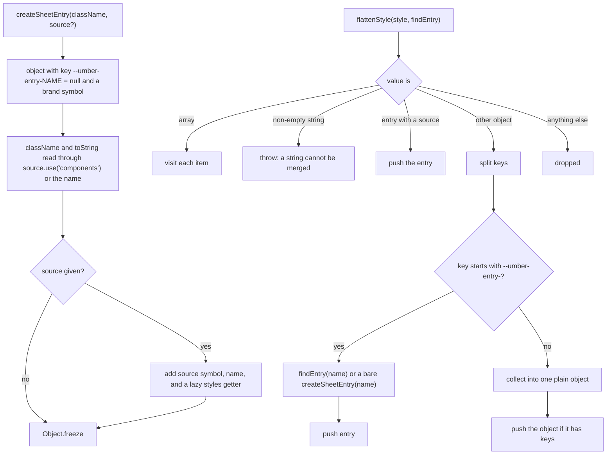

# sheetEntry.ts

## What it does

Makes and reads sheet entries, the objects a sheet holds for each name. `createSheetEntry(className,
source?)` returns a frozen object that prints as its class name. `isSheetEntry` knows one,
`readEntrySource` gives what a cache made it with, `findEntryCache` finds the cache of the first entry in a
list, `readEntryStyle` gives the style of an entry, and `flattenStyle` turns a `style` prop into a flat
list of entries and plain style objects.

## Why it exists

A sheet entry has to work in three places at once: as a class name on a plain element, as a value in the
`style` prop of a styled component, and as a style to merge into another class. A framework may copy,
spread or merge it on the way (Vue merges the objects of an array). The entry therefore has a branded
shape, one enumerable key that survives a merge, and a hidden source that a cache fills in so that the
rule is written when the entry is used, not when it is made. `flattenStyle` reads a `style` prop back into
entries after such a merge. Importers: `cache.ts`, `createEngine.ts`, `css.ts`, `globalStyles.ts`,
`templateStyle.ts`, `styleTypes.ts`, `types.ts`, and the bindings (`createStyle.ts`, `styledParts.ts`,
`styled.ts`).

## The logic

Reading `className` or the string form calls `source.use('components')`, which writes the rule the first
time. `styles` is read once and kept. An entry without a source is only a name.

## The data

A sheet entry is the object `{ '--umber-entry-<className>': null, [BRAND]: true }` with non-enumerable
`className`, `toString`, and, with a source, `[SOURCE]`, `name` and `styles`. `EntrySource` has `style`,
`cache`, `use(role)` and `readStyles()`; a role is `components` (on its own) or `overrides` (given to a
styled component). The test shows that two entries spread together keep two keys,
`['--umber-entry-a', '--umber-entry-b']`, and `flattenStyle` gives back `['a', 'b']`.

## What it guarantees

- An entry is frozen, and its only enumerable value is `null`, so a plain element renders no `style`
  attribute (the test `holds nothing a plain element would write`).
- A rule is written on first use of the class name, never when the entry is made.
- A merge of style objects keeps every entry, because each has its own key.
- `flattenStyle` keeps order: entries and plain keys come out in the order met, with the plain keys of one
  object collected together after its entries.
- `readEntryStyle` throws a `TypeError` that names the caller for an entry that is only a name.

## Decisions

- The brand and the source are `Symbol.for` symbols, so two copies of the packages recognise each other's
  entries.
- A spread copies the brand but not the source (the source is non-enumerable), so an entry with a source is
  taken to be whole, and a spread copy falls back to its key (comment inside `flattenStyle`).
- A style given as a string is an error: a text style cannot be merged into a class.
- The reason for the key prefix `--umber-entry-` over another form is not recorded; the comment ties it to
  Vue's merging of style objects and to both frameworks skipping a `null` value on a plain element.

## Limits

- An entry that is only a name has no style: `readEntryStyle` throws, and a template merge throws the
  same (`templateStyle.ts`).
- `findEntry` is optional; without it an entry found by key is a bare name entry.
