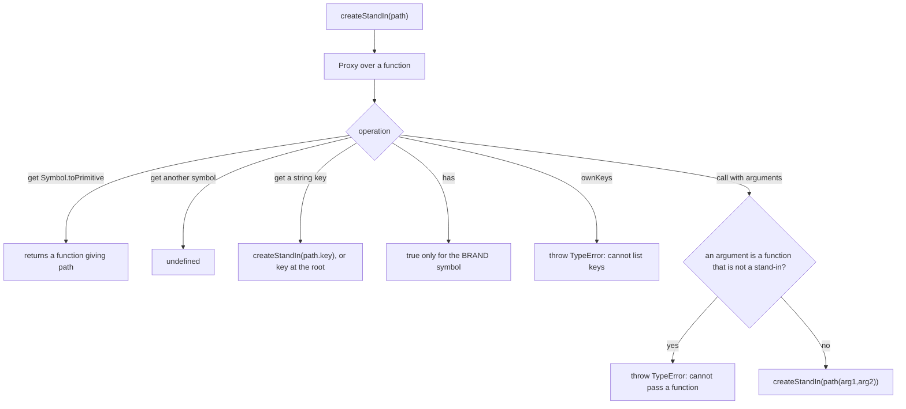

# standIn.ts

## What it does

`createStandIn(path)` makes a proxy that stands for the theme at `path`. Reading any key gives a stand-in
one level down, calling it gives a stand-in for `path(arguments)`, and as text it is its path. `isStandIn`
tells one from any other value, and `readStandIn` gives the path text of a stand-in, or the value itself.

## Why it exists

`keyframes()` and `globalStyles()` can be given a function of the theme, and their names (a class, a
keyframes name) are made before a theme exists. Calling the function with a stand-in turns every token it
reads into a text path (`palette.primary`), so the name can be a hash of that text, independent of the
theme's values. The helpers that compute with a token (`alpha`, `calc`) take a stand-in as the text of a
reference. Importers: `alpha.ts`, `calc.ts`, `keyframes.ts`, `globalStyles.ts`.

## The logic

The proxy target is a function so that a call works. `isStandIn` reads the brand with `in`; `readStandIn`
returns `String(value)` for a stand-in.

## The data

Paths are dotted; the root is `''`. From `standIn.test.ts`: `String(theme.palette.primary)` is
`palette.primary`; `String(theme.breakpoints.up('md'))` is `breakpoints.up(md)`;
`String(theme.breakpoints.between('sm', 2).x)` is `breakpoints.between(sm,2).x`; `String(theme)` is `''`.

## What it guarantees

- Reading never throws except through `ownKeys` and a call with a foreign function.
- A path is deterministic from the keys read, so two functions that read the same tokens get one name.
- A symbol key reads as `undefined` (except `Symbol.toPrimitive`), so a symbol read does not make a
  stand-in.
- It touches no browser global.

## Decisions

- Listing keys (`Object.keys`, a spread, `for...in`) throws, because an empty list would give two different
  functions the same name.
- A function given to a helper such as `breakpoints.up(fn)` throws, because the function can close over
  values that its text does not show, and two such calls would get one name.

## Limits

- A function that branches on a token's value cannot be named by its path; the stand-in has no value.
- The error messages say `keyframes()` or `globalStyles()` even when another caller uses it.
