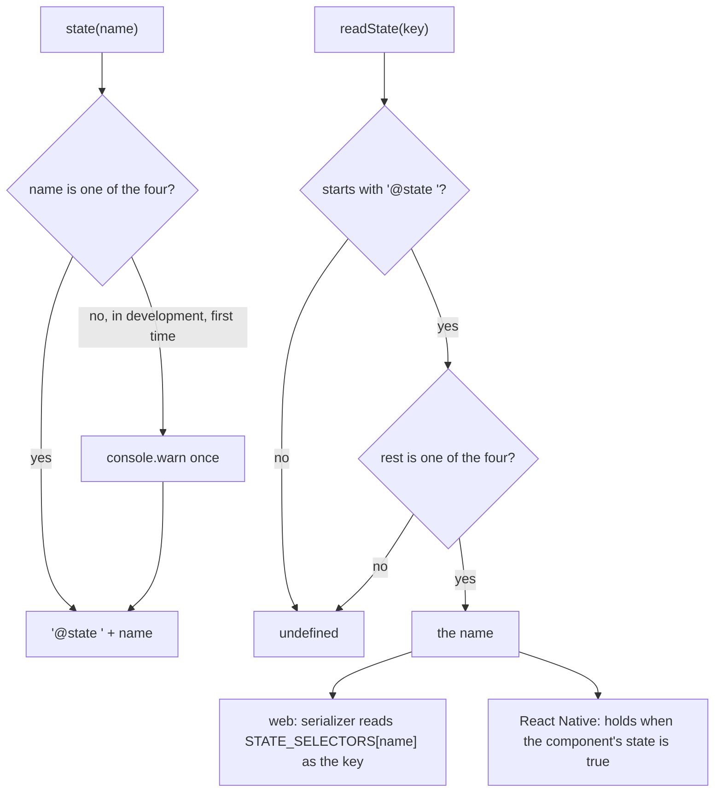

# state.ts

## What it does

Holds the vocabulary of the state keys: the four names (`hovered`, `pressed`, `focused`, `disabled`), the
key `state(name)` makes (`@state pressed`), `readState(key)`, which reads the name back, and
`STATE_SELECTORS`, the selector key each state is written as on the web. In development `state()` warns
once about a name that is not one of the four.

## Why it exists

A hover, press, focus or disabled style written as a selector key (`&:active`) exists only on the web: React
Native drops it. A shared style needs one key that each platform reads in its own way, as `whenScheme()`
gives `@scheme dark` to both. The web writes a state key as the selector an author writes by hand, so the
CSS does not change and no script runs; React Native evaluates it against what the component is doing.
The key, the names and the selectors must be one definition for the serializer (`serialize.ts`) and the
React Native binding (`readState` in `conditions.ts`, `toNativeStyle.ts` and `warnStyle.ts` of that
package). `index.ts` exports all of it; every binding re-exports `state`.

## The logic

## The data

`StateName` is the union of the four names. `StateKey` is `` `@state ${string}` ``: typed as any `@state`
key, as the key of `when()` is any `@theme` key, so that a key alone in an object literal, or spread from
`at`, passes the style types of every platform (a literal key that no style type has would be an excess or
a weak-type error on React Native). `STATE_SELECTORS` from `state.test.ts`:

| State      | Selector key                          |
| ---------- | ------------------------------------- |
| `hovered`  | `&:hover`                             |
| `pressed`  | `&:active`                            |
| `focused`  | `&:focus-visible`                     |
| `disabled` | `&:disabled, &[aria-disabled="true"]` |

## What it guarantees

- `readState(state(name))` is `name` for each of the four, and `readState` is undefined for any other key,
  for `@state` with another name, and for a name of `Object.prototype` (`@state toString`): the names are a
  `Set`, not the keys of an object.
- A style with a state key compiles to the same rules, class name and order as the same style with the
  selector key (`state.test.ts`, and the binding tests of React, its server build and Vue).
- The warning is given once for each unknown name, only in development (`isDevelopment()` of
  `devChecks.ts`, written out in front of it so that a production bundle leaves the warning and its text
  out: `devChecks.md`), and the key is returned all the same.
- Nothing touches a browser global.

## Decisions

- One key on every platform, translated by the reader, rather than `state()` returning the selector on the
  web and another key on React Native: a style is the same data wherever it is made (a package that imports
  `state` from the core gives a style that both bindings read), as with `whenScheme()`.
- `focused` is `&:focus-visible`, keyboard focus, on the web; React Native has no way to tell keyboard focus
  from touch focus, so there it is any focus. One name, two documented meanings (decided by the owner,
  issue #42).
- `disabled` covers the attribute and `aria-disabled="true"`, which React Native's `aria-disabled` and
  `accessibilityState.disabled` correspond to.
- An unknown name is not an error: it is written as an at-rule, which the browser drops, as an unknown
  `@scheme` key is.

## Limits

- The set is fixed: a state of the component itself (selected, expanded, checked) stays in a function style.
- A JavaScript caller can write `@state pressd` by hand; only `state()` warns, and the key matches nothing.
