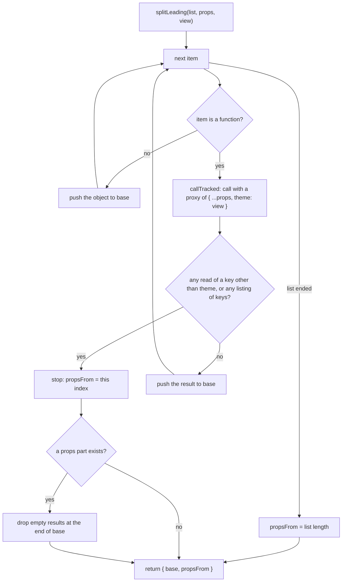

# styleBase.ts

## What it does

Splits the style list of a component into a base and a props part. `splitLeading(list, props, view)` walks
the list from the start and takes the longest run of items that do not depend on props: plain objects, and
functions that read nothing but `theme`. It returns the results of that run (`base`) and the index of the
first item that depends on props (`propsFrom`, or the length of the list when none does). `isStyleFunction`
tells a function style from an object.

## Why it exists

With a base class, the engine writes the part of a component's style that does not change with props once
(a class made once for the component and the theme), and a second class for the props part that changes at
each render. Without the split, every distinct prop value would write the whole style again. To split, the
engine must know which style functions use props, and the only way is to call them and watch what they
read. `createEngine.ts` calls `splitLeading` (when `hasBaseClass` is on) and `isStyleFunction`.

## The logic

The proxy notes `get`, `has` and `getOwnPropertyDescriptor` of any key but `theme`, and notes `ownKeys` as a
dependence always (so a spread or `Object.keys` count). The function is called with the real props, so
what it does, a throw included, is the same as without tracking.

## The data

Input: a list of `StyleInput` (objects or functions), the props of this call and the theme view. Output:
`{ base: StyleResult[], propsFrom: number }`. In the test, `[{ a: 1 }, fn reading theme]` gives
`base: [{ a: 1 }, { c: 'var(--x)' }], propsFrom: 2`.

## What it guarantees

- The theme view is passed as it is, never wrapped, so a read of the theme does not make a function depend
  on props.
- Destructuring a prop counts as a read, even when the prop is absent (`notes a prop that is read by
  destructuring, even when it is not there`).
- Every way of listing the props is noted: spread, `Object.keys`, `in`, and a descriptor read.
- Each leading function is called once here per call.
- When a props part exists, empty results at the end of the base (nothing, or an object with only `label`)
  are dropped, so the base is the same for a component and for one that wraps it.

## Decisions

- Dependence is found by running the function and observing reads, not by analysing its text.
- Everything after the first dependent item is the props part, even a plain object after it, to keep the
  order of the cascade (`stops at the first function that reads a prop, and everything after it is the
  props part`).
- The trimming of trailing empty results is for the label that stands right before the props part (comment
  on `splitLeading`).

## Limits

- A function that reads props only on some calls (a branch) is detected only if that branch runs in this
  call; a call that does not read them is taken as independent for that call.
- The first function that depends on props is called once here only to find that out, and its result is
  dropped.
