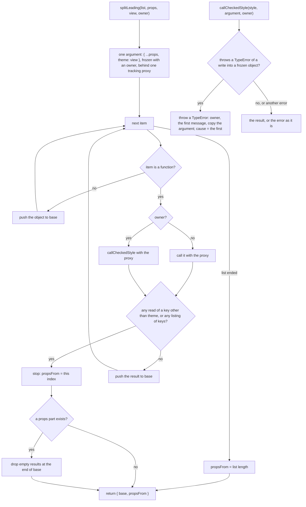

# styleBase.ts

## What it does

Splits the style list of a component into a base and a props part, and holds what calling a style function
needs. `splitLeading(list, props, view, owner?)` walks the list from the start and takes the longest run of
items that do not depend on props: plain objects, and functions that read nothing but `theme`. It returns
the results of that run (`base`) and the index of the first item that depends on props (`propsFrom`, or the
length of the list when none does). `isStyleFunction` tells a function style from an object.

`createStyleArgument(props, theme, isFrozen)` makes the one argument of the style functions of an element
in a render, frozen in development. `callCheckedStyle(style, argument, owner)` calls a function with that
frozen argument and turns the `TypeError` of a write into it into an error that names the component.

## Why it exists

With a base class, the engine writes the part of a component's style that does not change with props once
(a class made once for the component and the theme), and a second class for the props part that changes at
each render. Without the split, every distinct prop value would write the whole style again. To split, the
engine must know which style functions use props, and the only way is to call them and watch what they
read. `createEngine.ts` calls `splitLeading` (when `hasBaseClass` is on) and `isStyleFunction`.

The argument: before 0.7.0 each function got a copy of its own (`{ ...props, theme }`), made for each
function in each render. The functions of an element now share one, made in the render and never kept,
so two renders never share it; in development it is frozen, so a function that changes it (which in
production the later functions of the element would see) throws at once. `createEngine.ts` and the React
Native binding use these; the binding gets `callCheckedStyle` from the entry of the core.

## The logic



The proxy notes `get`, `has` and `getOwnPropertyDescriptor` of any key but `theme`, and notes `ownKeys` as a
dependence always (so a spread or `Object.keys` count). The function is called with the real props, so
what it does, a throw included, is the same as without tracking. A read of a prop ends the run, so the note
is false at each call of the run and one proxy serves every function.

## The data

Input: a list of `StyleInput` (objects or functions), the props of this call, the theme view and, with the
development checks, the owner (`[css] A style function of "Box"`). Output:
`{ base: StyleResult[], propsFrom: number }`. In the test, `[{ a: 1 }, fn reading theme]` gives
`base: [{ a: 1 }, { c: 'var(--x)' }], propsFrom: 2`.

The error of a write, copied from `createEngine.argument.test.ts`:

```
[ar] A style function of "Box" threw a TypeError of a write into a frozen object: Cannot add property
tone, object is not extensible. In development the argument of a style function is frozen: it is one
object, the props with the theme, shared by the style functions of the element in a render. Copy the
argument before changing it: const own = { ...props }.
```

## What it guarantees

- The theme view is passed as it is, never wrapped by the tracking, so a read of the theme does not make a
  function depend on props.
- Destructuring a prop counts as a read, even when the prop is absent (`notes a prop that is read by
  destructuring, even when it is not there`).
- Every way of listing the props is noted: spread, `Object.keys`, `in`, and a descriptor read.
- Each leading function is called once here per call, and every function of the call gets the same object.
- When a props part exists, empty results at the end of the base (nothing, or an object with only `label`)
  are dropped, so the base is the same for a component and for one that wraps it.
- `callCheckedStyle` throws again only a `TypeError` whose message is one of a write into a frozen object
  (`FROZEN_WRITE`, the words of the JavaScript engines); any other error, the theme guard's included, is
  thrown as it is.

## Decisions

- Dependence is found by running the function and observing reads, not by analysing its text.
- Everything after the first dependent item is the props part, even a plain object after it, to keep the
  order of the cascade (`stops at the first function that reads a prop, and everything after it is the
  props part`).
- The trimming of trailing empty results is for the label that stands right before the props part (comment
  on `splitLeading`).
- The argument is frozen with `Object.freeze`, not wrapped in a Proxy with traps: a frozen object costs
  nothing to read, and the engine pays the freeze in development only. The price is that the error comes
  from the language, so `callCheckedStyle` recognises it by its message and names the component.

## Limits

- A function that reads props only on some calls (a branch) is detected only if that branch runs in this
  call; a call that does not read them is taken as independent for that call.
- The first function that depends on props is called once here only to find that out, and its result is
  dropped.
- The render that plans the base for a view gives its functions the tracked argument here, and the props
  part of the same render another argument (`createEngine.ts`): two objects in that one render.
- A frozen object throws on a write in strict mode code only; a function in sloppy mode code changes
  nothing and gets no error. A write into another frozen object of the function's own is reported with the
  same advice, its first message kept.
