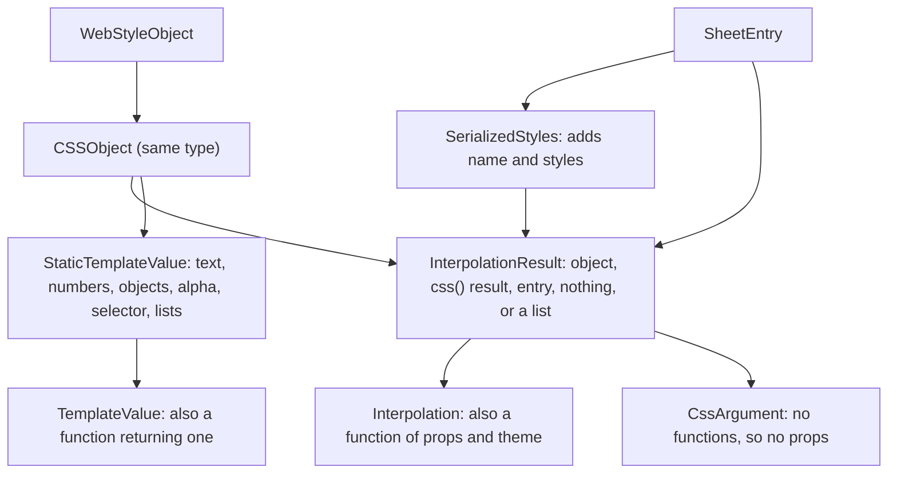

# styleTypes.ts

## What it does

Holds only types: the names an app annotates a style with and the shapes that `styled`, `css()` and the
template tags take. `CSSObject` is `WebStyleObject` under another name. `Keyframes` is what `keyframes`
returns. `SerializedStyles` is a sheet entry with `name` and `styles`. `InterpolationResult`,
`Interpolation`, `CssArgument`, `StaticTemplateValue` and `TemplateValue` describe what a style function, a
`css()` call and a tagged template may hold. `ComponentSelector` is a component that stands for a selector.

## Why it exists

The web bindings and the plain `css` package must accept the same inputs, and a type that two of them need
belongs in core. Keeping the shapes here means the bindings re-export one definition, and an app can
import `CSSObject` or `Interpolation` from any of them. The file has no runtime code, so it adds nothing to
a bundle. Importers: `css.ts`, `globalStyles.ts`, `keyframes.ts`, `createEngine.ts`, and `index.ts` for
re-export.

## The logic

`Interpolation<Props, T>` is the `styled` form: a function receives `Props & { theme: T }`.
`CssArgument` is the `css()` form: the same without functions, since `css()` has no props. In a template,
`StaticTemplateValue` lists what may sit between the strings (including `null`, `undefined`, `true` and
`false`, which write nothing); `TemplateValue` adds a function of the props and theme.

## The data

`SerializedStyles.styles` is CSS in the engine's text format: declarations, then nested rules with `&` for
the class, for example `color:red;&:hover{opacity:0.5;}@media (min-width: 40em){&{padding:16px;}}` (the
doc comment). Reading `name` or `styles` writes no rule.

## What it guarantees

- No runtime code: the compiled file is empty.
- A `ComponentSelector` is any object with a `_styles` array; a styled component prints as `.<class>`.
- `css()` accepts no function, in the types.

## Decisions

- Types live in core, not in a binding, so that `css`, React and Vue share them.
- The default theme type of `Interpolation` is `Theme` from `types.ts`, which an app extends by merging.
- The reason `ComponentSelector` is typed by the single member `_styles` is not recorded in the code.

## Limits

- The types say what is accepted, not what is written: a value that no CSS property takes is a runtime
  matter (`findInvalidValues.ts`).
- Tests for these types are `styleTypes.default.test.ts` and `styleTypes.strict.test.ts`; they check
  assignability only.
