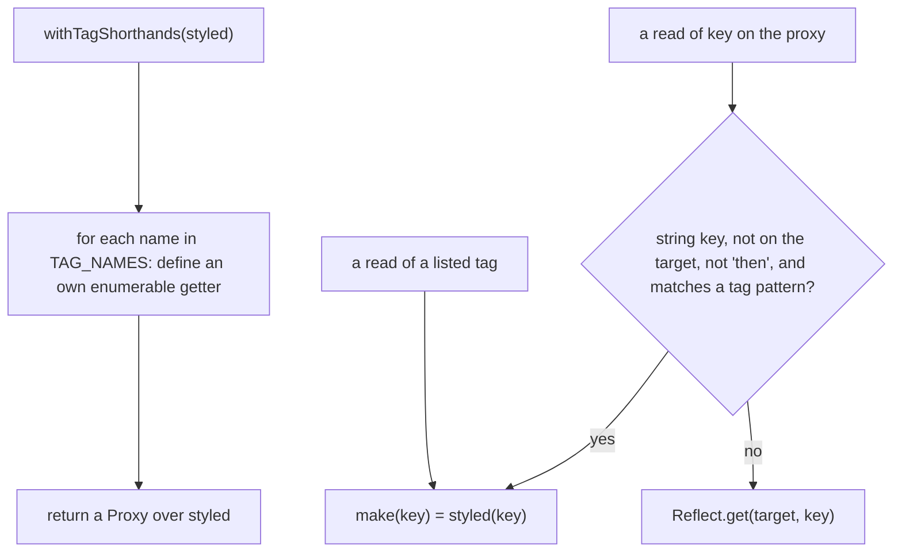

# tagShorthands.ts

## What it does

`withTagShorthands(styled)` adds a member for each HTML and SVG tag to the `styled` function, so that
`styled.div(...styles)` is `styled('div')(...styles)`. It defines each tag as an own, enumerable getter and
returns a `Proxy` that also makes a member for any other key that looks like a tag name.

## Why it exists

Every web binding offers `styled.div`, `styled.button` and so on. Writing that list and the lazy creation
once, in core, means React, React server and Vue share it. The members are getters so nothing is built
until it is read, and enumerable so `Object.assign(wrapper, styled)` copies them to a wrapper. Importers
are the bindings: React `styled.ts`, `styled.server.ts`, `defaultStyle.ts`, `defaultStyle.server.ts`, and
Vue `styled.ts`, `defaultStyle.ts`.

## The logic

The pattern is a lowercase letter followed by letters and digits (`div`, `h1`, `foreignObject`). A key that
the function already has (`length`, `name`, an own member) is read from the function.

## The data

`TAG_NAMES` is a constant list of HTML and SVG tag names, from `a` to `view`, including legacy ones such as
`center` and `keygen`, and SVG names in camelCase such as `foreignObject` and `feGaussianBlur`.

## What it guarantees

- Each read makes a new `styled(tag)`; nothing is made before a member is read.
- `then` is never a tag, so `styled` is never taken for a promise (for example in an `await`).
- A symbol key, a key with an uppercase first letter (`Div`) and a key with a hyphen (`data-x`) make
  nothing (`keeps the members of the function, and makes nothing for other keys or then`).
- The tags are own enumerable members, so `Object.assign` copies them.

## Decisions

- Both the explicit list and the open pattern exist: the list makes `Object.assign` and editors work, and
  the pattern covers a tag the list lacks. The comment says "Another member that the function does not
  have and that looks like a tag name is made when it is read too".
- The list is what React types as elements (comment on `TAG_NAMES`).

## Limits

- A custom element name with a hyphen (`my-element`) is not a tag member; the pattern does not match it.
- A tag with an uppercase first letter is not made.
- The list is fixed in the file: a new tag needs an edit here.
