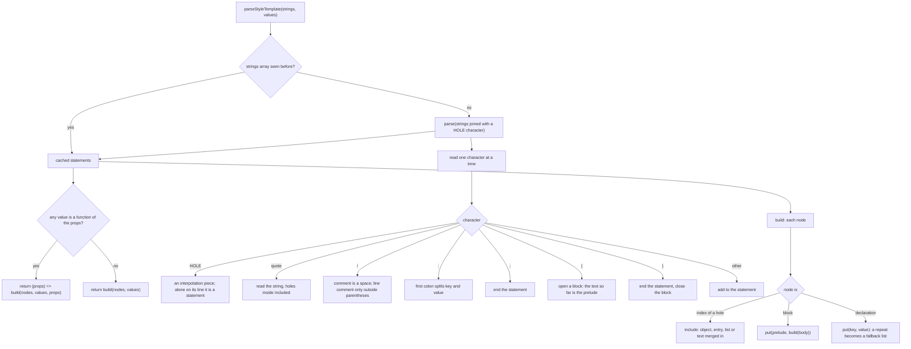

# templateStyle.ts

## What it does

Reads the CSS text of a tagged template into a style object. `parseStyleTemplate(strings, values)` returns
a `StyleObject` when no interpolation is a function, and a function of the props that calls them when one
is. `parseKeyframesTemplate` reads the steps (`from { } 50% { } to { }`) the same way and returns what
`keyframes()` takes. `isTemplateStrings` tells the strings array of a tagged call from other input.

## Why it exists

It lets `css`, `styled`, `keyframes` and `globalStyles` be written as CSS text with `${}` holes and still
go through the one serializer: the text becomes the same object that an object style would be, so the same
class name follows (`parseStyleTemplate compiles as the equal object style`). It is a single-pass reader
rather than a pattern, so hostile text cannot make it backtrack, and the split of the text is cached by the
strings array, so a call site pays for it once. Importers: `css.ts`, `globalStyles.ts`, `keyframes.ts`
(and `packages/css/src/createInstance.ts` and the bindings through `index.ts`).

## The logic

A statement is a declaration (it has a `:`), a block (it ends in `{`) or an interpolation alone between
declarations. A hole in a value, a selector or a property name is text; one alone merges a style object, a
sheet entry (its style), CSS text or a list. `null`, `undefined`, `true` and `false` give nothing. An
`alpha()` result that is the whole value is kept so its fallback is written.

## The data

`TemplateNode` is a hole index, a `Declaration { key, value }` or a `Block { prelude, body }`; a `Text` is a
string when final, else a list of pieces (static text and hole indexes). A property becomes camelCase
(`-webkit-x` is `WebkitX`, and the serializer writes it back as it was); a custom property stays as
written. The `templates` WeakMap holds the nodes by strings array.

## What it guarantees

- The text is split once for each strings array, and filled in on each call.
- A value is kept as text: `padding: 8px` is `'8px'`, so a unitless number gets no unit.
- A property declared twice in a block becomes a fallback list at the place of the last.
- A nested selector written twice is merged, the later declarations winning.
- It does not change a style object that it merges.
- Errors are `TypeError` with the line and the text around the place: unclosed string, comment, block or
  parenthesis, a block without a selector, a `}` without a `{`, a declaration without a property, a
  declaration without `:`.
- A style object in a value, a selector or a property name throws; a sheet entry that is only a name
  throws when merged.

## Decisions

- An interpolation on its own line, followed by a character that does not continue a selector or property,
  is a statement of its own (`OWN_LINE`); one that is followed by `{`, `,`, `:`, `>`, `+` or `~` is kept
  as part of what follows.
- A line comment `//` is read outside parentheses only, so `url(http://x)` is not cut.
- A function whose `toString` is its own (a stand-in, a component that is a selector) is text, not a
  function of the props (`isCallable`).
- A function that returns a function is called until it is not one.

## Limits

- It reads declarations, nested rules and at-rules with blocks; it is not a full CSS parser and does not
  validate property names or values.
- The cache by strings array holds a WeakMap entry for each call site; none for a call with a new array.
