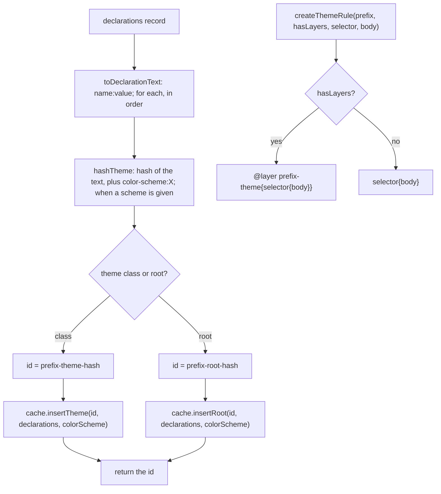

# theme.ts

## What it does

Turns the variable declarations of a theme into the rules and names that the cache needs.
`createThemeClass(cache, declarations, options)` registers the theme class for the declarations and
returns its name, `<prefix>-theme-<hash>`. `declareRootTheme` does the same for the root theme and returns
`<prefix>-root-<hash>`. `createThemeId` computes the class name without registering it. `createThemeRule`
and `toDeclarationText` write the text of a rule and its declarations. `ROOT_SELECTOR` is `:where(:root)`.

## Why it exists

A theme is a set of custom property declarations. Its name must depend on the whole declarations (and the
color scheme), so that the same theme always gets the same class, and a changed theme gets a new one. The
cache writes the rule, but the naming and the text format are theme concerns, kept here so the server
(`createThemeId`, used by the React server `ThemeProvider` to name a class without a cache write) and the
client agree. Importers: `cache.ts` (the text and rule helpers), `createEngine.ts`
(`createThemeClass`, `declareRootTheme`), and `index.ts`, which re-exports `createThemeId`.

## The logic

The hash is of all the declarations, whatever the cache writes of them: with pruning, a theme class may
declare only the variables that rules use, but its name does not change with that (see `hasPruning` in the
doc comment of `createThemeClass`). The cache itself writes the rule text, with the help of
`createThemeRule`.

## The data

`declarations` is `Record<string, string>`: `{ '--a': 'b', '--c': 'd' }` gives the text `--a:b;--c:d;`. In
the test, the rule is `.ds-theme-<hash>{--a:b;--c:d;}`, and with `colorScheme: 'dark'` it ends
`color-scheme:dark;`. `ThemeRuleOptions.colorScheme` is `light`, `dark` or `light dark`.

## What it guarantees

- The same declarations (and scheme) give the same class and one rule (`gives the same declarations the
  same class and one rule`).
- Different declarations give a different class.
- A theme with no variable returns a class and inserts no rule.
- `createThemeId` returns the name `createThemeClass` would, with no registration.
- The theme class carries no style registration of its own in `cache.registered`.

## Decisions

- The name is a hash of the whole text, not of the pruned text, so that pruning does not change class
  names.
- The color scheme is part of the hashed text, so one theme in two schemes gets two classes.
- The root theme gets a different id prefix (`root`), so a theme class and a root rule do not collide.
- The reason the root rule uses `:where(:root)` is given by the doc comment: no specificity.

## Limits

- Declaration order changes the hash: the same declarations in another order are another theme class.
- `ROOT_SELECTOR` is also defined in `scanStyleText.ts`; the two must stay equal.
