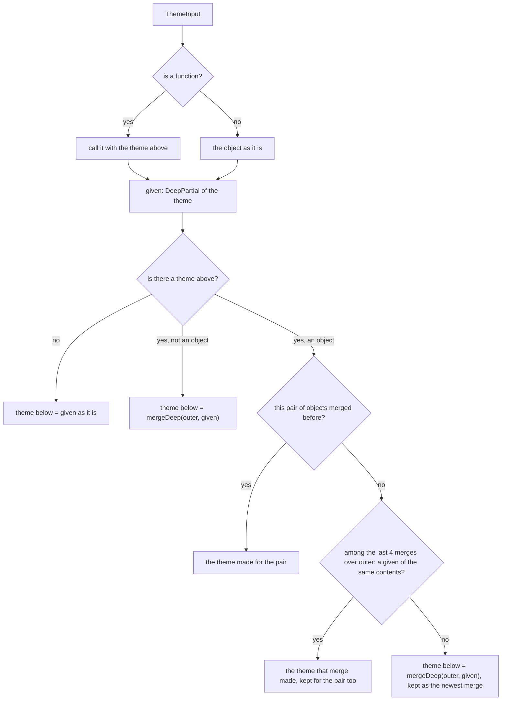

# themeInput.ts

## What it does

Defines what a theme provider is given and how it is merged. `ThemeInput<T>` is the theme or a part of it,
or a function of the theme above that returns that. `resolveThemeInput(input, outer)` calls the function
or returns the object. `mergeTheme(outer, given)` merges `given` over the theme above, or takes `given` as
it is when there is none above; a `given` with the contents of one merged over the same theme above before
gets the theme that merge made. `EMPTY_THEME` is a frozen empty object for where there is no theme.

## Why it exists

Every binding has a provider that nests: React `ThemeProvider` and `ThemeValue`, Vue `ThemeProvider`, React
Native `ThemeValue`. The rule for what is below a provider has to be the same in all, so it is written
once. The bindings call `resolveThemeInput` and `mergeTheme` and use `EMPTY_THEME` as the outer theme at
the top (React `ThemeProvider.tsx`, `ThemeProvider.server.ts`, `ThemeValue.tsx`, `createStyle.server.ts`;
Vue `ThemeProvider.ts`, `Global.ts`, `createStyle.ts`; React Native `ThemeValue.tsx`).

## The logic

## The data

`ThemeInput<T>` is `DeepPartial<T> | ((outer: T) => DeepPartial<T>)`. In the tests,
`mergeTheme({ a: { b: 1, c: 1 } }, { a: { b: 2 } })` gives `{ a: { b: 2, c: 1 } }`, and
`mergeTheme(undefined, given)` returns `given` itself.

## What it guarantees

- An object input is returned as it is, not copied (`toBe(given)`).
- With no theme above, the theme is the given object itself.
- Over one theme above, a given of the same contents (`isSameTheme` of `sameTheme.ts`) gives the same
  object: a provider given a new object with the same contents in every render (a server render of an app
  whose own provider makes its theme in the render) passes on one theme, whose root rule and view the
  engine already has. Its contents are those a new merge would make: the same keys in the same order and
  the same values, the branches that only `given` has coming from the earlier `given`.
- `EMPTY_THEME` is frozen and has no key, so it is never changed.
- It touches no browser global.

## Decisions

- The merge is a deep merge (`mergeDeep.ts`), so a provider changes one value and keeps the rest.
- A function input receives the theme above, so a nested provider can derive its values from it.
- The reason `EMPTY_THEME` is typed `object` rather than a specific shape is not recorded in the code.
- The merges are kept in two ways, in the module. By the pair of objects first (a `WeakMap` by the theme
  above, of `WeakMap`s by the given): a stable theme over a base theme, a light one and a dark one, pay the
  merge once each, and the theme is the same object in every render, so `useTheme()` is referentially
  stable and a component that memoises on it does not render again; the pair goes when either object is
  collected. Then by contents: the last 4 givens of distinct contents over each theme above, and what they
  made, held for as long as that theme above lives. An app that gave the engine its library's base theme
  and its own theme to a provider paid about 0.5 ms more in each render of a page of every component
  (13.0 against 12.45 ms) for the new merged object and the work it made again.
- A theme above that is not an object (which `mergeDeep` replaces by `given`), or a given that is not one
  (nothing: the theme above), is merged as before, without being kept.

## Limits

- `mergeTheme` takes `undefined` as "no theme above"; an outer value that is `null` is not treated that
  way.
- The merge rules for arrays and special objects are those of `mergeDeep.ts`, not defined here.
- The merge kept relies on what the engine assumes already: neither the theme above nor a given is
  changed after it is used.
