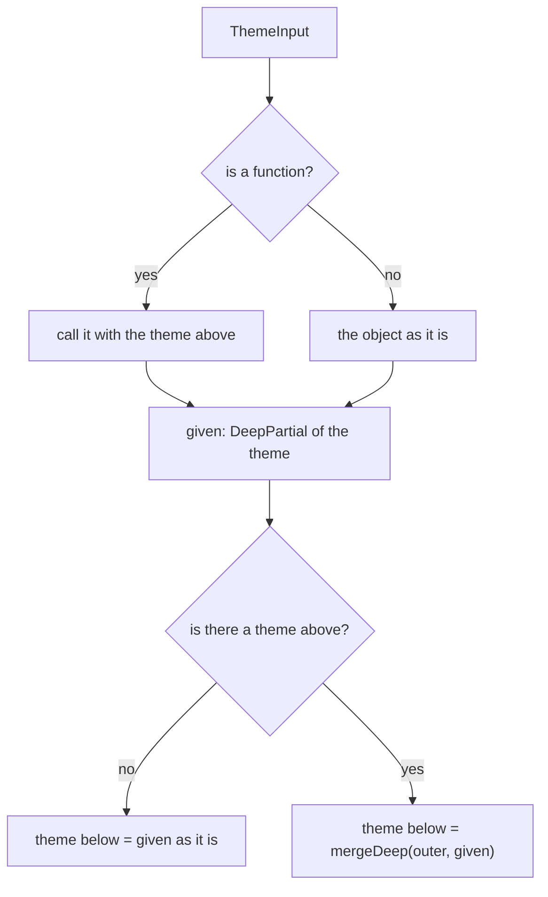

# themeInput.ts

## What it does

Defines what a theme provider is given and how it is merged. `ThemeInput<T>` is the theme or a part of it,
or a function of the theme above that returns that. `resolveThemeInput(input, outer)` calls the function
or returns the object. `mergeTheme(outer, given)` merges `given` over the theme above, or takes `given` as
it is when there is none above. `EMPTY_THEME` is a frozen empty object for where there is no theme.

## Why it exists

Every binding has a provider that nests: React `ThemeProvider` and `ThemeValue`, Vue `ThemeProvider`, React
Native `ThemeValue`. The rule for what is below a provider has to be the same in all, so it is written
once. The bindings call `resolveThemeInput` and `mergeTheme` and use `EMPTY_THEME` as the outer theme at
the top (React `ThemeProvider.tsx`, `ThemeProvider.server.ts`, `ThemeValue.tsx`, `createStyle.server.ts`;
Vue `ThemeProvider.ts`, `Global.ts`, `createStyle.ts`; React Native `ThemeValue.tsx`).

## The logic

## The data

`ThemeInput<T>` is `DeepPartial<T> | ((outer: T) => DeepPartial<T>)`. In the tests,
`mergeTheme({ a: { b: 1, c: 1 } }, { a: { b: 2 } })` gives `{ a: { b: 2, c: 1 } }`, and
`mergeTheme(undefined, given)` returns `given` itself.

## What it guarantees

- An object input is returned as it is, not copied (`toBe(given)`).
- With no theme above, the theme is the given object itself.
- `EMPTY_THEME` is frozen and has no key, so it is never changed.
- It touches no browser global.

## Decisions

- The merge is a deep merge (`mergeDeep.ts`), so a provider changes one value and keeps the rest.
- A function input receives the theme above, so a nested provider can derive its values from it.
- The reason `EMPTY_THEME` is typed `object` rather than a specific shape is not recorded in the code.

## Limits

- `mergeTheme` takes `undefined` as "no theme above"; an outer value that is `null` is not treated that
  way.
- The merge rules for arrays and special objects are those of `mergeDeep.ts`, not defined here.
