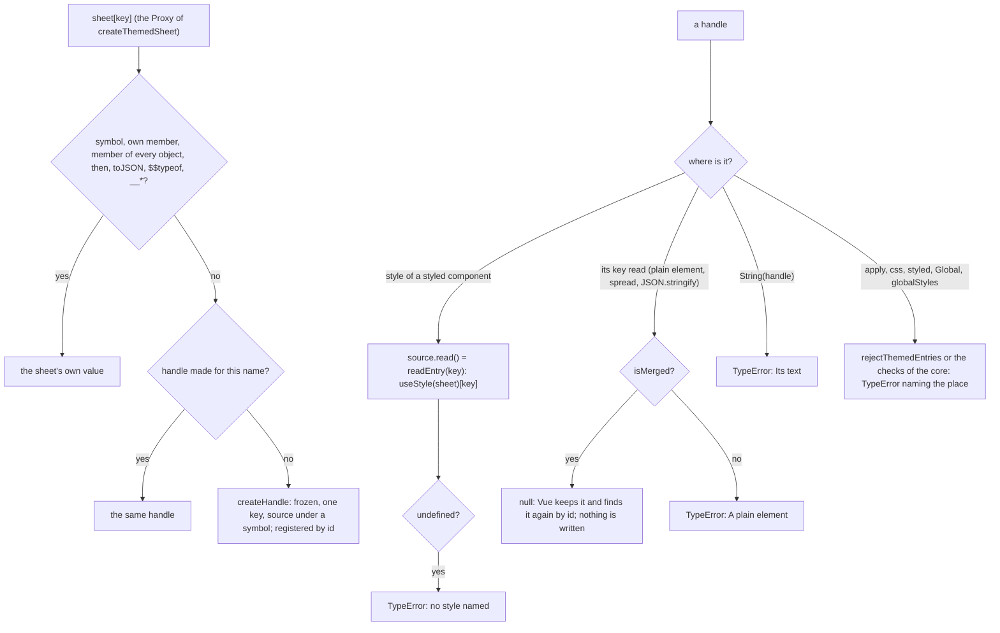

# themedEntry.ts

## What it does

Makes the handles of a sheet made from a function of the theme. `StyleSheet.create((theme) => ...)` has no
entries until it is resolved against a theme; `createThemedSheet(sheet, options)` wraps such a sheet so that
reading a name (`sheet.card`) gives a handle: a frozen object that stands for "the entry `card` of this
sheet, under whatever theme the reader has". A styled component resolves it with its own theme
(`flattenStyle` in the web bindings, `themedStyle.ts` on React Native). Everywhere else a handle is a
`TypeError` that says where it was given and what to use instead.

## Why it exists

A design system takes only sheet entries in `style`. Without handles, every themed override in an app would
need a `useStyle(sheet)` call first (#88). The sheet is made once at module level, so a handle is a named
value, not an inline function, and the `style` prop still takes no function. A handle computes nothing: the
binding's `readEntry(key)` (its own `useStyle(sheet)[key]`) is called when the component renders, so the
class and the rule are exactly those of `useStyle(sheet).card` under the same provider.

## The data

- A handle is `{ '--umber-themed-<sheet id>.<name>': ... }`, frozen, with non-enumerable members: the source
  under the `Symbol.for('umber-style.themed-entry')` symbol (`{ sheet, key, read }`) and a `toString`. It
  has no `toJSON`.
- The one enumerable key holds `null` when `isMerged` is given: Vue, whose merge of the objects of a list
  keeps only enumerable keys (`flattenStyle` finds the handle again by its id in `handles.byId`), and the
  server components build of React, whose development messages read every key of a prop. Without it (the
  client build of React, React Native) the key is a getter that throws, so that a plain element, which
  reads every key of its `style`, gets the `TypeError` of a plain element, and so do a spread and
  `JSON.stringify`.
- `handles` is shared state (`core.themed-entries@1`): every copy of the core finds a handle by its id.
- `ThemedEntry` is an opaque type, a brand on a `unique symbol`; `ThemedEntries<K, Own>` gives one handle
  type for each name of the sheet except the names that pass through, so a misspelt name is a type error.

## What it guarantees

- One handle for each name of each sheet, made on first read, frozen and kept: `sheet.card === sheet.card`.
- A handle is resolved only by a styled component, with its own theme; it never guesses a theme.
- Every error a handle raises is a `TypeError` whose message starts with the place (`apply()`, `css()`,
  `styled()`, `Global`, `globalStyles()`, `A plain element`, `Its text (a class name)`, or `A class (apply,
  css(), the styles of styled)` from the cache) and says to give it to the style prop of a styled
  component, or to read it from `useStyle(sheet)` first.
- `Object.keys(sheet)` is what it was: the Proxy has only a `get` trap.

## Decisions

- A Proxy rather than a record of handles made up front: the names of a function sheet are not known until
  the function runs, and running it needs a theme.
- Names that frameworks and serializers read on any object pass through, so that the sheet is not taken for
  a promise (`then`), a React element (`$$typeof`), a reactive or module object (`__v_*`, `__esModule`), or
  serialized through a handle (`toJSON`). A style with such a name gets no handle.
- `readEntry` is optional: React Native resolves the source itself, reading the providers and the window
  once for every handle of a render (`themedStyle.ts`), so its sheet gives none and its `read` is never
  called.
- A handle does not cross from a server component to a client component: it has no `toJSON`, and the CSS
  of a style never crosses (the owner withdrew decision 3 of #88). A client component imports the sheet
  and is given a plain value that chooses the style.
- The handles of the React server components build hold `null` (`isMerged`): React reads every key of a
  prop for its development messages (an object given to a client component), and a key that throws made
  the page fail on the development server. The cost is the `TypeError` of a plain element in that build
  (see Limits).

## Limits

- A handle in Vue's `class` attribute, or on a plain Vue element's `style`, writes nothing and raises no
  error: Vue reads its key, which holds `null` there. The same holds for the `style` of a plain element in
  a server component of React (`
`), whose handles hold `null` too: decision 2 of
  #88 (a `TypeError` there) is met by the types only in that build. `String(handle)`
  (`className={sheet.card}`) still throws.
- `handles.byId` keeps every handle for the life of the program: one for each name of each sheet.
