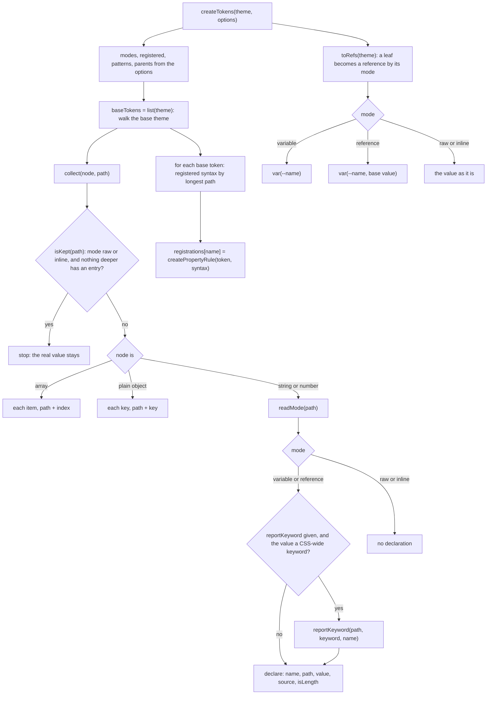

# tokens.ts

## What it does

`createTokens(theme, options)` turns a theme object into variable references and the declarations that
give them values. It returns `refs` (the theme's shape with `var(--name)` in place of each variable token),
`declare(partialTheme)` (the custom property declarations of a theme or a part of one), `createView(real)`
(the shape of another theme like `refs`), `findNames(paths)` (variable names under dotted paths) and
`registrations` (the `@property` rule of each registered variable). `findMissingPaths` reports option
paths that a theme does not have. `createTokens(theme, options, reportKeyword)` tells `reportKeyword` (the
development check of an engine) about each variable or reference token declared with a CSS-wide keyword. It also defines `TokenMode`, `TokenOptions`, `DeepPartial` and `Tokens`.

## Why it exists

The engine's central idea is that a style reads `var(--palette-primary)`, never the color, so a theme change
is a change of declarations and no style is rewritten. Something must walk the theme once, name each
variable, decide which values are variables and which stay real (breakpoints, functions), and make the
references. That is this file. Importers: `createEngine.ts` (the whole object), `themeInput.ts` and
`types.ts` (the types `DeepPartial` and `TokenOptions`), `mergeDeep.ts`, and `index.ts`.

## The logic

`readMode(path)` takes the longest path that has an entry in `modes`; at one length an exact path comes
before a pattern, and of two patterns the one with fewer `*` wins. Without an entry the mode is `raw` for a
top-level key in `rawKeys` (default `breakpoints`, `components`), else `variable`. A name is `--` plus the
prefix and each key part (`toSegment`: camelCase becomes kebab-case, other characters become `-`). A number
under a length key (default `space`, `sizes`, `radii`, `fontSizes`, `borderWidths`) is declared in px, except 0.

## The data

From the tests: `refs.palette.primary` is `var(--palette-primary)`; `refs.space[2]` is `var(--space-2)`;
`refs.fontSizes['x-large']` is `var(--font-sizes-x-large)`; in `reference` mode with prefix `u`,
`refs.palette.primary` is `var(--u-palette-primary, #0b57d0)`; `declare({ palette: { primary: 'red' } })` is
`{ '--u-palette-primary': 'red' }`. Modes: `variable`, `inline`, `reference`, `raw`.

## What it guarantees

- The same theme and options give the same names and the same references.
- A function, a boolean and anything that is not a string, a number, an array or a plain object stays as
  it is in `refs`.
- `declare` of a partial theme writes only the variable and reference tokens it has.
- A `reference` fallback is the base theme's declared value, and none when the base has no such token.
- Only variable and reference tokens are registered; never inline or raw ones.
- A variable or reference token whose value is `inherit`, `initial`, `unset`, `revert` or `revert-layer`
  (any letter case, white space around it or not) is told to `reportKeyword`, with its dotted path, the
  keyword in lowercase and its variable, each time it is declared: in the base theme when the tokens are
  made, and in any theme given to `declare`. A raw or inline token is never told: it has no variable.
  Without `reportKeyword` nothing is looked at.
- An entry of `modes` is not taken from the prototype of the options object.

## Decisions

- A leaf with an entry deeper down is not kept even in a `raw` or `inline` parent: `hasDeeper` makes a
  deeper variable work inside an inline parent (`takes a deeper variable inside a parent that is inline`).
- Patterns with `*` are matched only when at least one exists (a fast path of exact lookups otherwise).
- With no entry in `modes` (or `registered`), `findByPath` returns at once, and `isKept` looks for a
  deeper entry only when there are any: the paths were joined and looked up for nothing. A key made only
  of lowercase letters, digits, `_` and `-` is its own segment, without the three rewrites of `toSegment`.
  The names are the same (`names a variable from each key as it did`); the tokens of a theme, which every
  engine of a fresh cache made again, took 30 to 40% less, a cold render of 48 fixed elements from 155 to
  97 us (host).
- **The check of a CSS-wide keyword is here, in `collect`,** the one place every declaration of every
  theme passes, so a keyword in a dark theme is found as well as one in the base theme. A custom property
  takes such a keyword as itself (`--x: inherit` takes the parent's value of `--x`), not as a value that
  `var(--x)` puts in a property, so the token does not do what it says. The engine warns (once for each
  path) and says what to write instead.
- `registered` is found like `modes`: the most specific path wins and a top-level key covers everything
  under it.
- `inline` and `raw` differ only in documentation and intent; the code treats them the same in `isKept` and
  `readMode`. The reason for two names is not recorded in the code.

## Limits

- `findMissingPaths` tells only that a dotted path has no match; it does not suggest a fix.
- Only plain objects and arrays are walked; a class instance in a theme stays as it is.
- A theme key that makes the same segment as another (`fooBar` and `foo-bar`) makes the same variable name.
