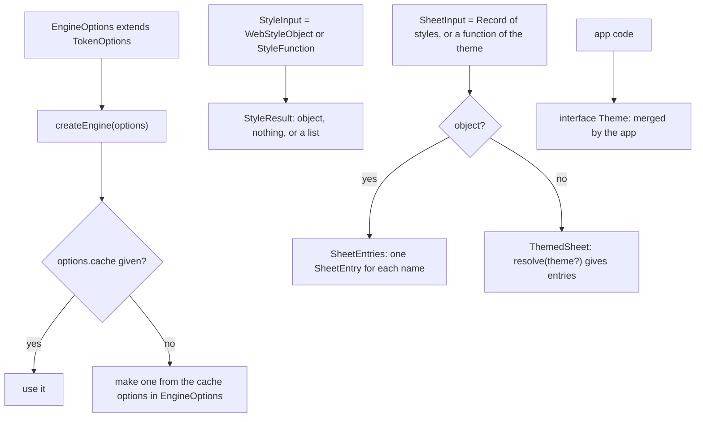

# types.ts

## What it does

Holds the types of the engine's public surface that no one file owns: `EngineOptions` (the options of
`createEngine`), `ColorScheme`, the style function types (`StyleResult`, `StyleFunction`, `StyleInput`),
`StylerOptions`, the sheet types (`SheetStyles`, `SheetInput`, `ObjectSheet`, `SheetEntries`,
`ThemedSheet`) and the `Theme` interface that an app extends. No runtime code.

## Why it exists

The engine and the three bindings talk in these types: a binding passes `EngineOptions` to the engine, a
styled component is made from `StyleInput` values, a sheet is made from `SheetInput`. Core owns them so
that the bindings share one definition. `Theme` is the one an app extends by declaration merging:
`declare module '@umber-style/core' { interface Theme extends MyTheme {} }`. Importers: `createEngine.ts`,
`styleBase.ts`, `styleTypes.ts`, `css.ts` and `index.ts`.

## The logic

`StyleResult` allows nested lists, so a function may return a list of results, and they merge in order.
`ObjectSheet<K>` adds `call?: never` so that a function of the theme is not taken for an object sheet.

## The data

`EngineOptions` adds to the token options: `prefix`, `suffix`, `hasLabels`, `hasLayers`,
`hasColorFallbacks`, `hasValueRepair`, `hasVendorPrefixes`, `hasScope`, `hasPruning`, `hasBaseClass`,
`hasStyleMemo`, `hasDevChecks`, `speedy`, `nonce`, `alwaysDeclare` and `cache`. Each comment gives its default (for example
`hasLayers` default true, `hasValueRepair` default false, `hasVendorPrefixes` default true).
`StylerOptions` has `name`, `slot` (default `root`) and `label`.

## What it guarantees

- No runtime code; importing it changes no bundle.
- `Theme` has no members of its own (the optional `_theme` only keeps it from being empty), so an app's
  members are the only ones.
- A sheet's entries are made on first access, and a rule is written when an entry is first used.

## Decisions

- `hasDevChecks` follows the environment by default (on when `process.env.NODE_ENV` is `development`), with
  `true` forcing it in a test run; with a `cache` given, the engine's checks follow the option, else that
  cache's.
- Options marked "used when the engine makes its cache" have no effect on a cache that is passed in,
  except `hasVendorPrefixes`, which also applies over a given cache.

## Limits

- The types check the shape of a style, not the CSS it writes.
- `Theme` is empty until an app merges into it, so a theme-typed function has no member types by default.
