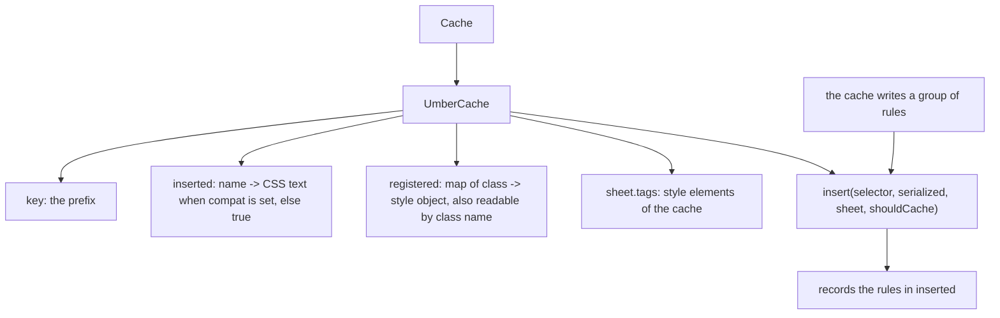

# umberCache.ts

## What it does

Defines the types of the engine's cache as server-rendering set-ups read it. `UmberCache` extends `Cache`
with `key`, `compat`, `inserted`, `registered`, `sheet` and an `insert` hook. `UmberSheet` has `tags`, the
style elements that hold the cache's rules. `SerializedRule` is `{ name, styles }`, a group of rules the
cache wrote. Types only: no runtime code.

## Why it exists

A server set-up (the `@umber-style/server` package, and the `@umber-style/cache` package that makes the
cache) needs members that the plain `Cache` does not have: the key, a record of what was inserted, and the
sheet's elements. The type lives in core, with the other types an app imports, and `@umber-style/cache`
re-exports it, so the shape is defined once. Importers of the type: `packages/cache/src/index.ts`,
`packages/css/src/createInstance.ts` and `index.ts`, `packages/react/src/types.ts`, and tests of the server
package.

## The logic

The cache calls `insert` after it writes a group of rules, with an empty `selector`, the name and CSS text
in `serialized`, and `shouldCache` true. A caller replaces `insert` with a function that calls the one it
replaces, to see every new rule once.

## The data

`inserted` is `Record<string, string | true>`: with `compat` set, the value is the CSS text; otherwise
`true`. The names of the `data-umber` elements on the page at start-up are `true`. `registered` is a
`ReadonlyMap<string, StyleObject>` plus an index by class name that is `true` for a class this cache made.
`SerializedRule.name` is a class, a theme class, a global id or `@keyframes:<name>`.

## What it guarantees

- It is a type: it adds nothing at run time.
- `tags` is empty without a document.

## Decisions

- `inserted` stores only `true` by default (`compat` false), so the text of every rule is not kept twice.
  The member is named `compat` because the registry file a server-rendering set-up already has sets
  `cache.compat = true` before it reads the text of each inserted group, and that file must keep working
  unchanged (`docs/cache-and-server.md`).

## Limits

- The behaviour of `insert`, `inserted` and `sheet` is in `cache.ts` and the `cache` package; this file
  says only the shape.
