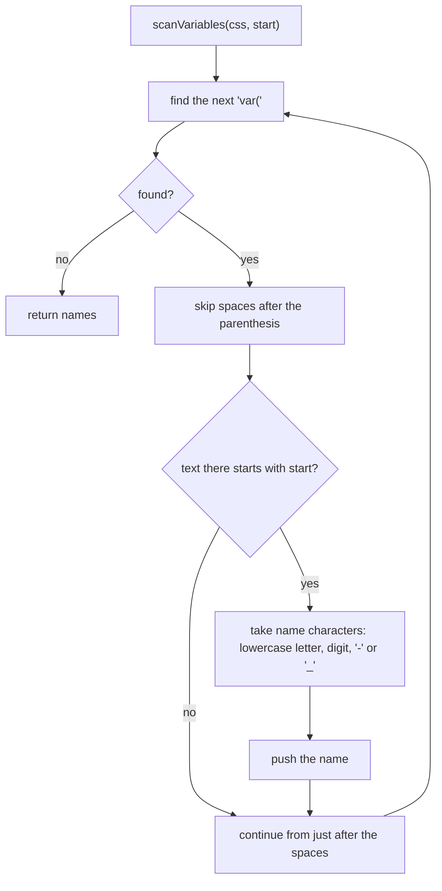

# variables.ts

## What it does

`scanVariables(css, start)` returns the names of the variables that `css` refers to through `var(...)` and
that start with `start` (`--<prefix>-`), in order of appearance, with repeats. A reference may have a
fallback, which may refer to others. It is one pass over the text.

## Why it exists

The cache needs to know which variables the rules use, so that a theme class declares only those
(`hasPruning`) and so that a page read at start-up (`scanStyleText.ts`) gives the same picture as a page
written by the cache. A pattern over the text could backtrack on a long input; a scan by index cannot.
Importers: `cache.ts` and `scanStyleText.ts`.

## The logic

The search resumes at `begin`, the first non-space character after `var(`, not after the name, so a
reference inside a fallback (`var(--u-b,var(--u-c,...))`) is found as well.

## The data

From the test: `scanVariables('x:var(--u-a, 8px);y:var(--u-b,var(--u-c,var(--other)))', '--u-')` is
`['--u-a', '--u-b', '--u-c']`.

## What it guarantees

- The output is in order of appearance and keeps repeats.
- A variable with another start, and `var(` with no name after it, add nothing.
- A name at the end of the text is found (`var(--u-end` gives `--u-end`).
- It is linear: 20000 openings are read in one pass (`is linear on a long text with many openings`).
- It touches no browser global.

## Decisions

- A name ends at the first character that is not a lowercase letter, a digit, `-` or `_`, so `--u-aB`
  gives `--u-a`: engine variables are lowercase by construction (`toSegment` in `tokens.ts` lowers them).

## Limits

- A variable written with an uppercase letter is cut at it.
- It does not read a variable in a string or a comment; it looks for the text `var(` only.
