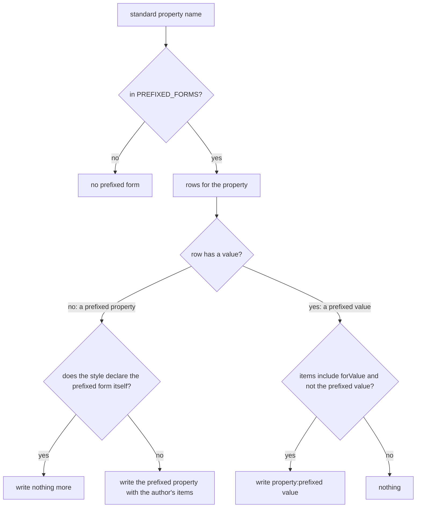

# vendorPrefixes.ts

## What it does

A table, `PREFIXED_FORMS`, of the declarations that a supported browser still needs in a prefixed form,
keyed by the standard property name, and the `PrefixedForm` type that describes one row. A row says a
prefixed property that takes the same value (`-webkit-user-select`), or, for one value of the property
(`forValue`, `stretch`), the same property with a prefixed value (`-moz-available`,
`-webkit-fill-available`).

## Why it exists

Some properties are still needed in a prefixed form by a browser inside the support window (the last two
years of Chrome, Edge, Firefox and Safari, iOS Safari included). The serializer writes each form before the
standard declaration, so a style author writes the standard property alone. The data is a table so that it
can be checked against the browser support page: a test asserts "an entry for exactly the properties of the
documented table". Importer: `serialize.ts` (`toDeclarations`). The table is documented in
`docs/browser-support.md`.

## The logic

`keys` holds the two spellings a style may declare the prefixed property under (`-webkit-user-select` and
`WebkitUserSelect`), made by `toPrefixed`. A row for a value has empty `keys`. `serialize.ts` writes the
text of every form first, then the standard declarations.

## The data

The table has keys `user-select`, `text-size-adjust`, `print-color-adjust`, `box-decoration-break`,
`initial-letter` and `text-decoration` (each with a `-webkit-` form), and for sizing `width`, `min-width`,
`max-width` (`stretch` as `-moz-available` then `-webkit-fill-available`) and `height`, `min-height`,
`max-height` (`-webkit-fill-available` only). The comment records that it was checked on 2026-11-22
against the browser compatibility data of MDN and caniuse.

## What it guarantees

- The map and its rows are read-only.
- Forms are written before the standard declaration, in the same rule, and the class name is not changed
  by them (`are written by default in a class, and the class has the name it has without them`).
- An author who writes the prefixed form is not written twice.
- Properties outside the table are left alone.

## Decisions

- Width stretch needs Firefox's `-moz-available` and Chrome before 138 and Safari before 27's
  `-webkit-fill-available`; height needs only the second (comments on `toWidthStretch`, `toHeightStretch`).
- The table is data, not code, so a release can change it by an edit and a test.

## Limits

- The table is as of one date; a browser release can make a row unneeded, and the file does not drop it
  by itself.
- Only the forms in the table are written; other prefixed properties are not.
- `vendorPrefixes.browser.test.ts` proves what a browser accepts; the unit test proves the text.
