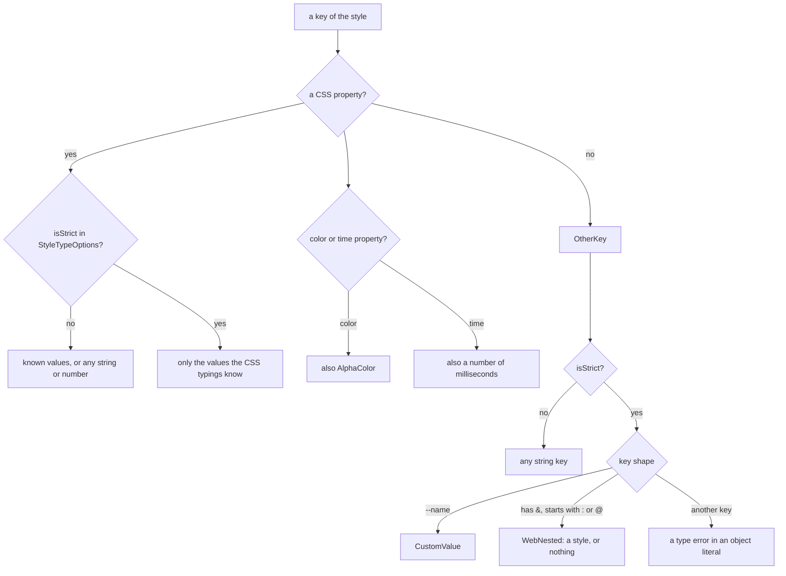

# webStyle.ts

## What it does

Defines `WebStyleObject`, the type of a style written for the web, and the property type it is built from,
`WebProperties`, plus `WebNested`. Every CSS property is keyed by its camelCase name with the value types
of the CSS typings. A color property also takes the result of `alpha()`, a time property also takes a
number of milliseconds, `display` takes the keyword forms of its grammar, and a key such as `label`, a
custom property, a selector (a key with `&`, or starting with `:`) or an at-rule (starting with `@`) is
accepted. Types only.

## Why it exists

A style object is the one input to the serializer, written by apps in many shapes. The type must help an
editor complete property names and values, accept what the engine handles (`alpha()`, numbers for a time,
nested styles), and let an app choose how strict to be. Without it each binding would define its own style
type. Importers: `types.ts`, `styleTypes.ts`, `sheetEntry.ts`, `createEngine.ts`, `css.ts`,
`globalStyles.ts`, `keyframes.ts`, `at.ts` and `index.ts`.

## The logic

`StyleTypeOptions` is an interface an app merges into, with `isStrict: true`, through
`declare module '@umber-style/core'` (or any web binding). `IsStrict` reads it.

## The data

`WebStyleObject = WebProperties & { label?: string } & { [K in OtherKey]: OtherValue<K> }`. `WebNested`
is `WebStyleObject | null | undefined | false`, so `isOpen && { ... }` works. A property value may be a
list (fallbacks tried in order), `null`, `undefined` or `false`.

## What it guarantees

- No runtime code.
- By default a style whose values were widened to `string` is accepted (`styleTypes.default.test.ts`).
- With `isStrict`, a misspelt property, a wrong value of a closed keyword set, and a key that is not a
  property, selector, at-rule or custom property are errors in an object literal.
- `display` is the one property whose misspelling is caught by default, because its grammar is a closed set
  of keywords (comment on `DisplayValue`).

## Decisions

- The loose form is the default, and strictness is opt-in per app, by declaration merging.
- A color property takes `AlphaColor`; a time property takes a number, but the `transition` and `animation`
  shorthands do not (`take a number of milliseconds for a duration or a delay, not for the transition
  shorthand`).
- A computed key (of type `string`) is rejected by the strict form and accepted through `at()`.

## Limits

- The type does not check what a variable holds, and does not check an untyped function's return (`does
  not catch what a variable holds, and does not check an untyped function return`).
- The CSS typings come from `csstype`; a property it lacks is not typed here.
