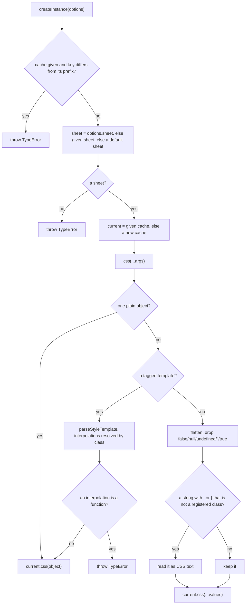

# createInstance.ts

## What it does

`createInstance(options)` makes a class-name instance with no theme and no framework: a cache (its own,
or one it is given) and the functions bound to it. `css` turns style objects, class names, CSS text and
tagged templates into one class; `cx` joins class names and merges those the cache made; `keyframes` and
`injectGlobal` write rules at once; `flush`, `hydrate`, `getRegisteredStyles` and `merge` manage the
cache. The `@umber-style/css/create-instance` subpath exports it as the default.

## Why it exists

Code that has no theme and no component tree still needs the engine's classes. This file wraps the core's
cache in a small API, and adds what a plain layer needs on top of it: reading CSS text, merging earlier
classes back into one, and sharing a cache with other code (a cache of `@umber-style/cache`). It is
imported by `src/index.ts` (the default instance), and by the tests and the fixtures that build their own
instance.

## The logic

The default sheet is the style elements of the document (`createDomSheet`, given `speedy` and `nonce`
of the options, so that an element it makes carries the nonce of a content security policy), or a memory
sheet when there is no `document`. `current` is a variable, so after `flush` the instance reads a new cache: the public
`cache` member is a proxy that reads `current` (or the given cache itself, which never changes).

`cx` collects class names from strings and from objects whose values are truthy, joins them, and calls
`merge`. `merge` counts the names the cache registered: with fewer than two it returns the string as it
is; with two or more it calls `current.css(className)`, which resolves them to styles and makes one
class, the last winning, with the other names in front. `keyframes` registers the steps, writes the rule
at once and returns the name. `injectGlobal` compiles each style and inserts it unless `hydrate` marked
its id. `hydrate` adds each id to a set and calls `insertOnce(id, [])`, so the cache believes the rule is
on the page. `getRegisteredStyles` pushes the styles of registered classes and returns the other names,
each followed by a space.

## The data

- `CssInput`, `ClassNamesInput`, `InjectGlobalInput`: nested lists of the accepted values.
- `SharedCache`: a core `Cache` that may carry a `sheet` (a core sheet, or the style elements of a cache
  of `@umber-style/cache`).
- `InstanceOptions`: the core's cache options with `key` (default `css`), `hasLayers` (default `false`
  here, the core's default is `true`) and `cache`.

## What it guarantees

- An equal style gives the same class and its rules are written once.
- The last style wins in a merge; other class names pass through in front.
- `flush` removes every rule from the sheet (if the sheet can remove), forgets the hydrated ids and
  starts an empty cache; a style is written again when next used.
- An instance given its cache never makes, replaces or empties one: `flush` throws a `TypeError`.
- Reading `document` happens inside a call, guarded by `typeof document`, never at module top level.

## Decisions

- `hasLayers` defaults to `false`, so a class of this package is an ordinary class next to the app's own
  CSS, which is not layered.
- A function interpolated in a template throws: there are no props or theme here to call it with.
- A string is CSS text only if it holds `:` or `{`; a registered class name is checked first, because
  such a name can itself hold `:` (test "resolves a class of this cache back to its style even when its
  name holds ':'").
- The common call, one style object, goes straight to the cache without flattening.
- When a cache is given, its own options are used and the other cache options are not read.

## Limits

- `flush` leaves the rules of a sheet that has no `remove` (test "leaves the rules of a sheet that
  cannot remove them").
- A given cache without a `sheet` member needs `sheet` in the options, or it throws.
