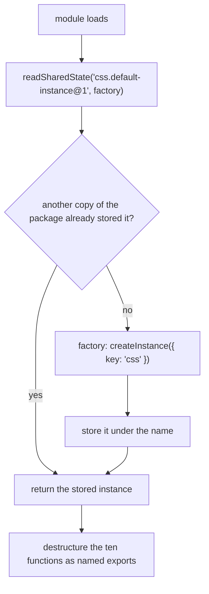

# index.ts

## What it does

The entry of `@umber-style/css`. It exports the default instance, with the functions `css`, `cx`,
`keyframes`, `injectGlobal`, `cache`, `sheet`, `flush`, `hydrate`, `getRegisteredStyles` and `merge`, and
the types of `createInstance` plus some types of the core (`CSSObject`, `Interpolation`, `Keyframes`,
`SerializedStyles`, `StyleTypeOptions`, `Theme`, `UmberCache`) under the names apps import.

## Why it exists

Most apps want one instance with the key `css` and no setup, so the package makes it. It is kept apart
from `createInstance.ts` so that the subpath `@umber-style/css/create-instance` can be imported without
making (or sharing) a default instance. Nothing else in the repository imports this entry except tests
and the fixtures.

## The logic

## The data

- The shared-state name `css.default-instance@1`: the `@1` is the version of the shape stored. Two copies
  of the package in one program read the same instance, so a class one copy made is merged and extracted
  by the other (`copies.test.ts`).

## What it guarantees

- One default instance for every copy of the package in the program.
- The default instance's rules are outside every cascade layer (`hasLayers` is `false` in
  `createInstance`; the test "writes its rules outside every cascade layer").
- The type re-exports have no runtime cost.

## Decisions

- The shared state lives in the core (`readSharedState`), which every copy also shares, so the package
  needs no global of its own.
- The instance's members are exported as separate names instead of one object, so an app imports `css`
  directly.

## Limits

- Changing the shape of the shared instance needs a new name (`@2`); an old copy would otherwise read an
  instance of the wrong shape. The code has no migration for that.
