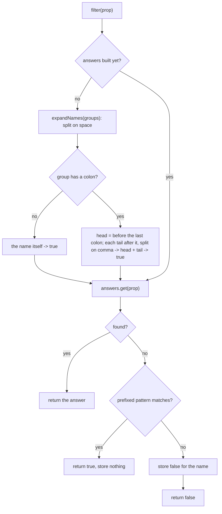

# propFilter.ts

## What it does

Two functions. `expandNames(groups)` turns a compact string of names into a `Map<string, boolean>` where
every name maps to `true`. `createPropFilter(groups, prefixed)` returns a predicate `(prop) => boolean`
that is true for the names the groups stand for and for any name a pattern matches, and false for any
other.

## Why it exists

Each platform file (`react.ts`, `vue.ts`, `react-native.ts`) holds a list of hundreds of prop names. Written
out, the lists would be long and costly to load. The group notation shortens them, and this file is the one
place that reads it and answers the question, so the three filters behave the same way. It is imported by
`react.ts`, `react-native.ts` and `vue.ts` of this package, and its test is `propFilter.test.ts`.

## The logic

## The data

- A group: `head:a,b` stands for `heada` and `headb`; `head:` (an empty tail) stands for `head` itself; a
  name with no colon stands for itself. The tails follow the LAST colon, so `xlink::href,role` stands for
  `xlink:href` and `xlink:role`.
- `answers`: `Map<string, boolean>`, made at the first call. It holds the listed names (`true`) and the
  names that were asked and refused (`false`).

## What it guarantees

- The same name always gets the same answer.
- The groups are expanded at the first call, not when the module loads, so loading the module costs
  nothing.
- A name that the pattern matches is never stored: apps make such names at run time (`data-row-${id}`)
  and storing them would grow the map with every one. The names that are stored are those of the code of
  the components, a set that does not grow while the app runs.
- Two filters share no state (test "keeps no state between two filters").
- A name that an object has on its prototype (`constructor`) is true only when it is listed: the lookup
  is in a `Map`.
- It touches no browser global and has no dependency, not even the core.

## Decisions

- The notation is lazy and text-based to keep the module small and its load free; the keys tests
  (`*.keys.test.ts`) list every name written out in full and prove each group still expands to them.
- A refused name is kept, so asking again is one lookup and not a pattern test.

## Limits

- A name that the pattern matches is tested by the pattern on every call, since it is not stored.
- A name that holds a colon must be written with a second colon (`xlink::href`); a single colon is read
  as a group.
