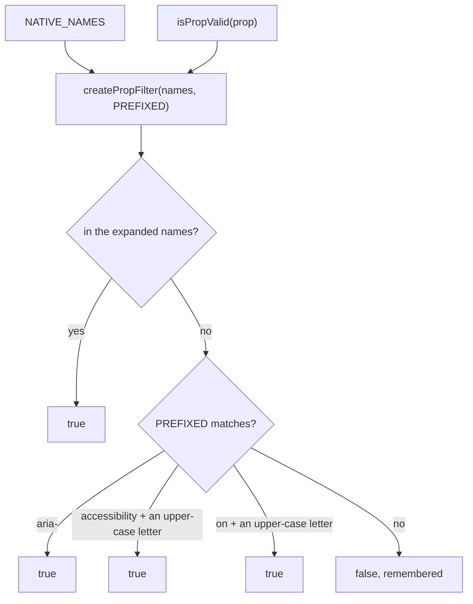

# react-native.ts

## What it does

Exports `isPropValid(prop)` (named and default): true when `prop` is a prop that one of React Native's
built-in components takes (`testID`, `numberOfLines`, `hitSlop`, `source`, `keyboardType`), an `aria-*` or
`accessibility*` prop, a handler (`onPress`), or `style`, `children`, `ref` and `key`. False for `as`,
`theme` and any other name. The entry of the package at `@umber-style/is-prop-valid/react-native`.

## Why it exists

A styled component of the React Native binding must pass only the props a native component accepts to it.
The web lists do not apply, so this is a separate list with its own entry. It is used by
`packages/react-native` (its dependency) and checked by its `propFilters.docs.test.tsx`.

## The logic

It does not use `WEB_NAMES`: no web attribute is a native prop, and the test "is false for ... the
attributes of the web" holds that.

## The data

`NATIVE_NAMES` is one string of groups. Its comment names the components it covers: View, Text, Image,
ImageBackground, TextInput, ScrollView, FlatList, SectionList, VirtualizedList, Pressable, Button,
Switch, Modal, ActivityIndicator, KeyboardAvoidingView, SafeAreaView, RefreshControl, StatusBar and the
three touchables; plus `testID`, `nativeID`, `style`, `children`, `ref` and `key`. Names such as
`color`, `size`, `width` and `height` are true because ActivityIndicator, Button and Image take them.

## What it guarantees

- A prop of a built-in component is true; `as`, `theme` and web attributes are false.
- The named and the default export are the same function.
- The groups are expanded at the first call.

## Decisions

- The list is the union of the props of the built-in components, not one list for each component, so the
  filter does not need to know the component.
- The named export is kept because a CommonJS build that imports this entry reads it.

## Limits

- A native component that is not built in takes the props it declares, which this filter does not know.
- A name that one built-in component takes passes for every component.
