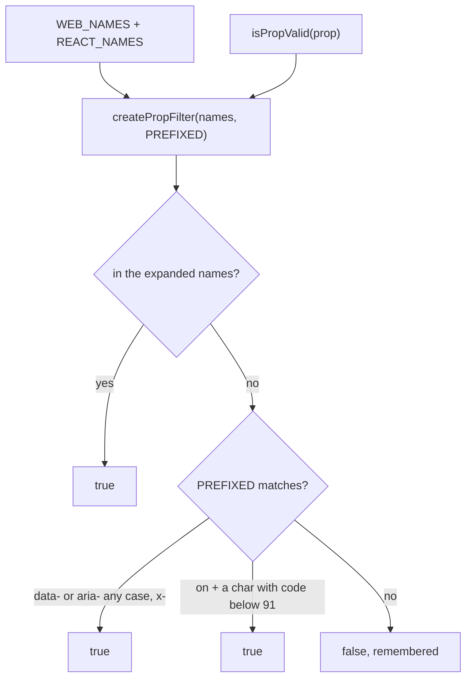

# react.ts

## What it does

Exports `isPropValid(prop)` (named and default): true when `prop` is a prop that React writes to an HTML or
SVG element under the name React gives it, and false for any other name, including `as`, `theme` and
variant props. The entry of the package at `@umber-style/is-prop-valid/react`.

## Why it exists

A styled component receives style props and element props together, and must forward only the latter to a
DOM element. This filter says which names are attributes. It lives in its own package that depends on
nothing, so it can be used without the engine. The React binding uses it as the default prop filter
(`packages/react/src/styledParts.ts`), and `@umber-style/styled` follows it through the binding.

## The logic

`REACT_NAMES` holds the names React spells in its own way: SVG presentation attributes in camelCase
(`strokeWidth`), HTML attributes React writes in camelCase where the DOM does not (`autoPlay`, `srcSet`,
`spellCheck`), React's own props (`children`, `dangerouslySetInnerHTML`, `suppressHydrationWarning`,
`precedence`) and older spellings apps forward (`valueLink`, `allowTransparency`, `fallback`).

## The data

`PREFIXED` is a pattern: `data-` and `aria-` in any letter case, `x-`, and `on` followed by any single
character whose code is below 91. That takes an upper-case letter (`onClick`) and also a digit, `-`, `:`
or `@`, because the predicate that apps use today accepts those too. The character class excludes the
code range from 91 to the last code unit, so that the source holds no control character.

## What it guarantees

- True for `children`, `ref`, `key` and `style`, and for `color`, `size`, `width` and `height`.
- False for `as`, `theme`, and names close to an attribute (`onclick` with a lower-case letter is
  covered by the test of names that are refused).
- The named export and the default export are the same function.
- No top-level work: the names are expanded at the first call.

## Decisions

- The default export exists "as the predicate apps use today is". The named export exists because a
  CommonJS build that imports this entry (the React binding's) reads the named export: its interop takes
  `module.exports` as the default.
- The pattern for `on` accepts more than an upper-case letter, on purpose, to match the predicate apps
  use today.

## Limits

- Only names are checked, not values or the element: `isPropValid('href')` is true for any element.
- A custom element's own attributes are not known unless they match the data or aria patterns.
