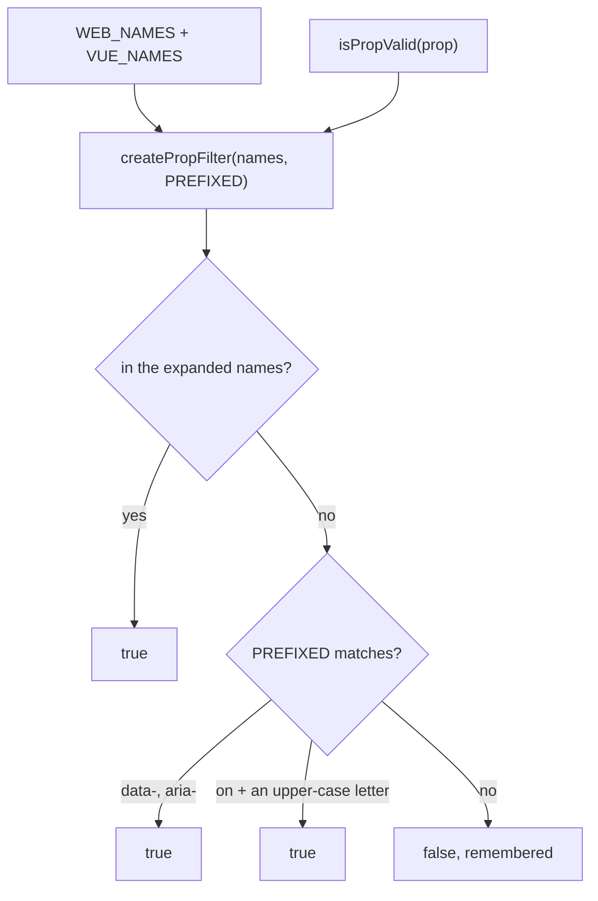

# vue.ts

## What it does

Exports `isPropValid(prop)` (named and default): true when `prop` is a prop that Vue writes to an HTML or
SVG element as a template or a render function writes it, and false for any other name, including `as`,
`theme` and variant props. The entry of the package at `@umber-style/is-prop-valid/vue`.

## Why it exists

A styled component of the Vue binding must forward only element props to the element it renders. Vue
spells many names differently from React (`tabindex`, `for`, `stroke-width`, `xlink:href`), so it has its
own filter. It is its own entry so that an app that uses one platform loads only that platform's names.
`packages/vue` lists the package as a dependency, and `packages/vue/src/propFilters.docs.test.ts` checks
it against `docs/`.

## The logic

`VUE_NAMES` holds the names Vue spells otherwise: HTML attributes in lower case (`tabindex`, `readonly`,
`for`, `http-equiv`), SVG presentation attributes in kebab-case (`stroke-width`), attributes of the XML
namespaces (`xlink:href`, `xml:lang`), DOM properties Vue sets by name (`innerText`, `textContent`,
`allowFullscreen`, `formEnctype`), and `ref_for` and `ref_key`.

## The data

`PREFIXED`: `data-`, `aria-`, and a listener: `on` followed by an upper-case letter (`onClick`,
`onClickOnce`, `onUpdate:modelValue`: the name after the letter may be anything). The match is
case-sensitive, so `DATA-row` is refused here, unlike in the React filter.

## What it guarantees

- True for `class`, `style`, `key`, `ref` and `is`, and for `color`, `size`, `width` and `height`.
- False for `as`, `theme`, `children`, and the React spellings Vue does not write (`strokeWidth`,
  `fillOpacity`, `xmlLang`, `dangerouslySetInnerHTML`), and for `onclick`, `DATA-row` and `x-init`
  (test "is false for as, theme ...").
- The named export and the default export are the same function; a CommonJS build reads the named one.
- Names are expanded at the first call, not at load.

## Decisions

- Namespaced attributes are written with a double colon in the groups (`xlink::href`), because the tails
  follow the last colon.
- The shared names (`WEB_NAMES`) are included, so a name both platforms spell the same way is written
  once.

## Limits

- Only names are checked, not the element.
- Because `WEB_NAMES` is shared, it also holds some names that are only React spellings of a DOM property
  (for example `className`); the Vue test list does not refuse them.
