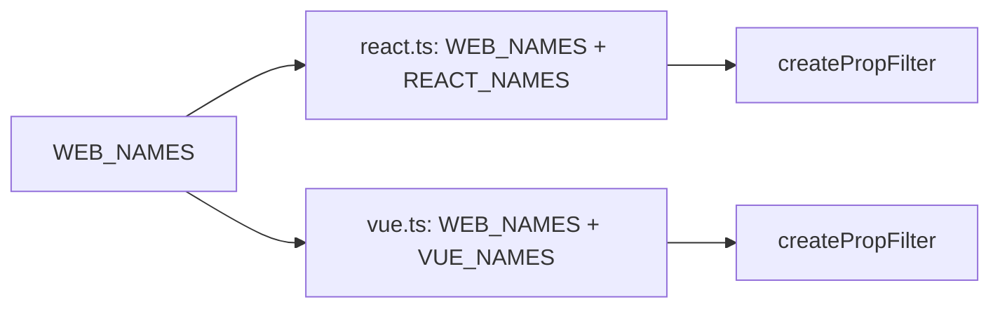

# webNames.ts

## What it does

Exports `WEB_NAMES`, one string of groups (the notation of `expandNames`) with the prop names that React
and Vue both write to an HTML or SVG element under the same spelling: one-word attributes (`alt`,
`href`, `d`, `cx`), the SVG attributes that are camelCase in XML (`viewBox`, `preserveAspectRatio`), the
DOM properties named as the DOM names them (`tabIndex`, `readOnly`, `className`, `htmlFor`), and `key`,
`ref` and `style`.

## Why it exists

The React filter and the Vue filter share most of their names. Keeping the shared part once means each
platform file lists only the names that differ (`REACT_NAMES`, `VUE_NAMES`). It is imported by `react.ts`
and `vue.ts`; `react-native.ts` does not use it, since React Native's components take other props.

## The logic

It holds no logic: the string is data, read by `createPropFilter` at the first call of a filter.

## The data

A single string, groups separated by spaces. Examples from the file: `accept:,Charset` stands for `accept`
and `acceptCharset`; `g:1,2` stands for `g1` and `g2`; `xlink:Actuate,Arcrole,Href,Role,Show,Title,Type`
stands for the camelCase names `xlinkHref`, `xlinkRole` and so on.

## What it guarantees

- Nothing is computed at load: it is a constant string.
- The names are in the same notation as the platform files, and the `*.keys.test.ts` files check every
  name each platform's filter must answer true for.

## Decisions

- Only the names that both platforms spell the same way are here. Spellings that differ (`strokeWidth` in
  React, `stroke-width` in Vue; `tabIndex` here and `tabindex` in Vue) are in the platform file of the
  one that uses them, and some lower-case forms appear in both the shared and the Vue string.

## Limits

- The list is a fixed set of names; a new attribute is not accepted until it is added here or in a
  platform file.
