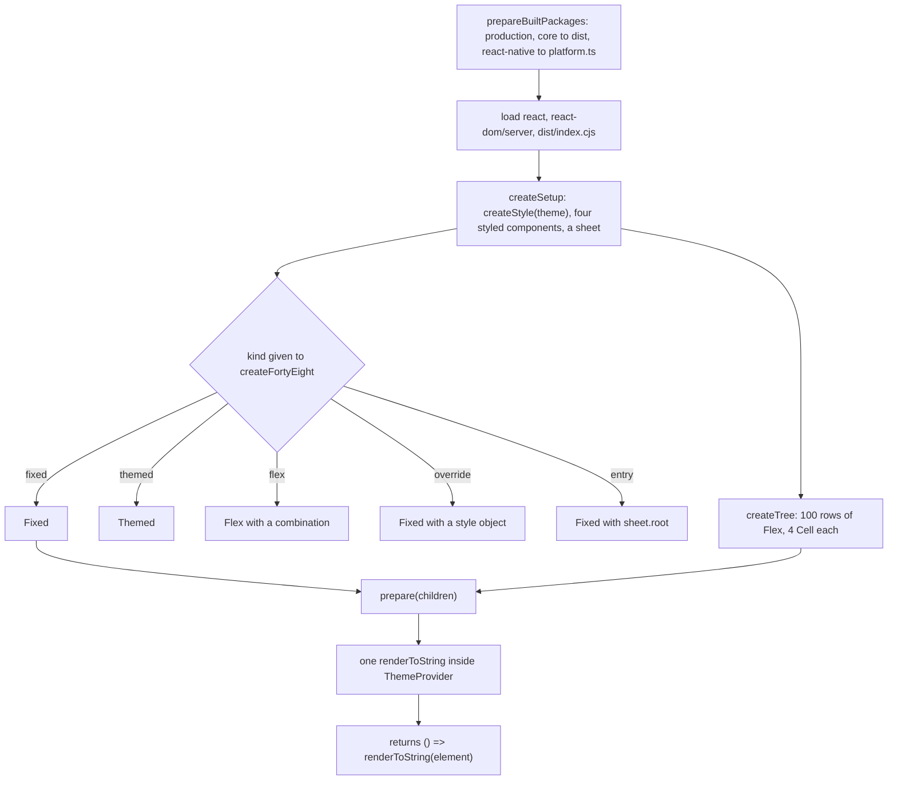

# fixtures.ts

## What it does

Makes the process run built code with `react-native` sent to `platform.ts`, then loads React,
`react-dom/server` and the built binding (`dist/index.cjs`). It exports the small `theme`, `createSetup()`
(a fresh style object and the components `Fixed`, `Themed`, `Flex`, `Cell` and a sheet over it),
`createFortyEight(setup, kind)`, `createTree(setup)` and `prepare(children)`.

## Why it exists

`styles-elements.bench.ts` and `styles-sheets.bench.ts` measure the binding's render of native
components. The sandbox sets no `NODE_ENV` and has no platform module, and the workspace link of the core
points at source; `prepareBuiltPackages` fixes those, and everything that reads them loads after it with
`createRequire` (`docs/benchmarks.md`). `View` is a stand-in for a native view: it renders an empty
`view` element around its children and drops its other props, so `react-dom/server` can render it.

## The logic

## The data

- 48 layout-prop combinations, keyed by `createLayoutKey`; the tree has 500 styled elements (100 `Flex`,
  400 `Cell`), and the tones of the cells are `TONES[0..3]`.
- `Flex` adds `alignItems: props.align` to the shared layout style.
- The sheet is `{ root: { margin: 4 }, other: { margin: 8 } }`.

## What it guarantees

- `prepare` renders once before it returns, so the operation measured is a render after the first.
- Each `createSetup()` has its own style object; a case does not share state with another.
- The warm render and the measured render use the same element.

## Decisions

- `LAYOUT_FIXED` and the layout style are cast to `NativeStyleObject`. The reason is not recorded in
  the code; the shared inputs in `bench/src/styles` are the web ones.

## Limits

- The style object is `createStyle(theme)` with no cache option, unlike the web fixtures.
- The tree has no `shift`: it is rendered with fixed props.
- It renders to a string with `react-dom/server`: no native layout or paint is measured.
