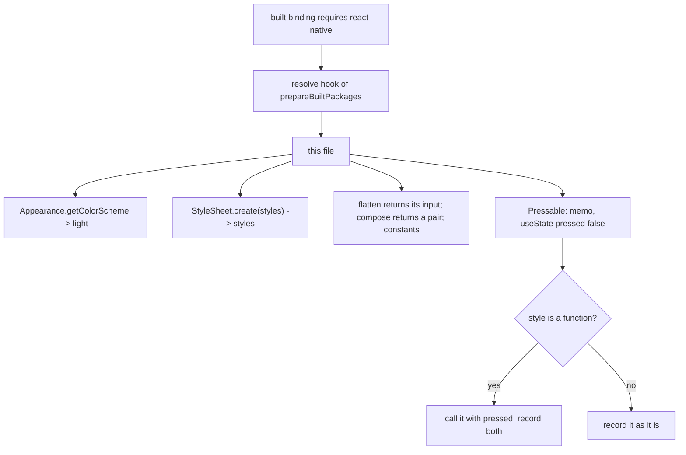

# platform.ts

## What it does

A stand-in for the `react-native` module with the members the binding reads: `Appearance.getColorScheme`
(always `'light'`), a `StyleSheet` with `create`, `flatten`, `compose`, `hairlineWidth`, `absoluteFill` and
`absoluteFillObject`, and a `Pressable`. `StyleSheet.create` returns its input. `Pressable` calls a function
`style` with `{ pressed }` (false) on each render, as the platform's does, and records in `lastPressable`
the `style` it was given and what it gave its view.

## Why it exists

Node cannot load the platform module. The built binding requires `react-native`, so
`prepareBuiltPackages` in `fixtures.ts` redirects that specifier to this file by URL. The benchmark files
of the package (`styles-elements.bench.ts`, `styles-sheets.bench.ts`, `states-pressables.bench.ts`) reach
it through `fixtures.ts`; `states-pressables.bench.ts` also loads it by the `react-native` specifier, so
that its `Pressable` is the object the built binding compares with (an import by path would load a second
copy). `create` is a plain function, so it records nothing and nothing grows with the number of operations;
the file's comment says the stand-in of the tests also returns its input.

## The logic

## What it guarantees

- The colour scheme is light, always: a benchmark never measures a scheme change.
- React is the production copy that the fixtures load: it is required after `prepareBuiltPackages`.
- `lastPressable` holds two values and is overwritten on each render, so nothing grows with the operations.
- It touches no browser global.

## Limits

- It has only the members above. A new member the binding reads from the platform needs an entry here.
- It does no layout and no validation of a style.
- `Pressable` is never pressed in a render to a string: a press is measured by calling the recorded
  `style` function, not by the platform's touch system, its timers or its re-render.
