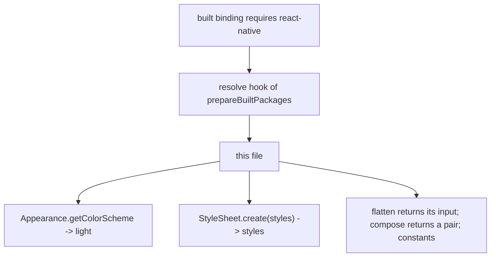

# platform.ts

## What it does

A stand-in for the `react-native` module with the members the binding reads: `Appearance.getColorScheme`
(always `'light'`) and a `StyleSheet` with `create`, `flatten`, `compose`, `hairlineWidth`,
`absoluteFill` and `absoluteFillObject`. `StyleSheet.create` returns its input.

## Why it exists

Node cannot load the platform module. The built binding requires `react-native`, so
`prepareBuiltPackages` in `fixtures.ts` redirects that specifier to this file by URL. The two benchmark
files of the package (`styles-elements.bench.ts`, `styles-sheets.bench.ts`) reach it only through
`fixtures.ts`. `create` is a plain function, so it records nothing and nothing grows with the number of
operations; the file's comment says the stand-in of the tests also returns its input.

## The logic

## What it guarantees

- The colour scheme is light, always: a benchmark never measures a scheme change.
- It keeps no state and touches no browser global.

## Limits

- It has only the members above. A new member the binding reads from the platform needs an entry here.
- It does no layout and no validation of a style.
