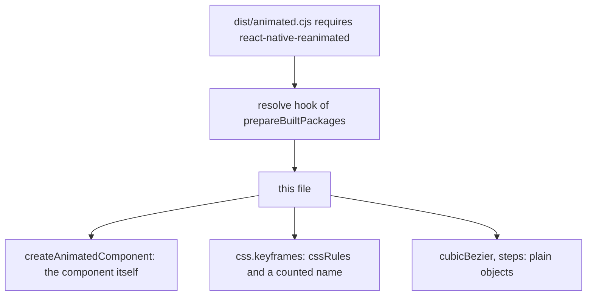

# reanimated.ts

## What it does

A stand-in for `react-native-reanimated` with the four functions the animated entry calls:
`createAnimatedComponent` returns the component itself, as the library's official mock does; `css.keyframes`
returns a rule object of the steps with a name of its own; `cubicBezier` and `steps` return plain objects of
their arguments.

## Why it exists

Node cannot load the library: it needs its native part and ships TypeScript source. The built animated entry
(`dist/animated.cjs`) imports it, so `prepareBuiltPackages` in `fixtures.ts` redirects that specifier here by
URL, for `animations.bench.ts`.

## The logic

## Limits

- What the library does with a style (its normalization, the native side) is not measured.
