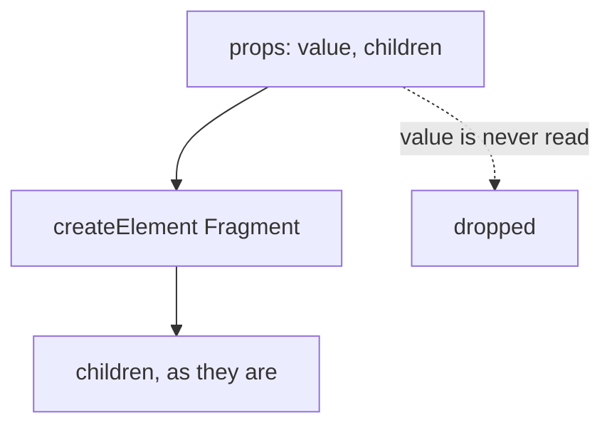

# CacheProvider.ts

## What it does

`CacheProvider` takes the props of the web component (`value`, `children`) and renders its children inside a
`Fragment`. It reads `value` never: there is no cache to give on React Native.

## Why it exists

A source file that wraps an app in `<CacheProvider value={cache}>` must compile and run on the web binding and
on this one. Without a component of the same name and props here, that source would not import. It is its own
file because `index.ts` re-exports it by name and `types.ts` holds its props (`CacheProviderProps`). The
only importer is `index.ts`.

## The logic

The component builds a `Fragment` element with `createElement` (no JSX, so the file is a plain `.ts`) and
passes the children through.

## What it guarantees

- It renders no host element and no context provider, so a tree under it is the same tree without it.
- It never reads, stores or validates `value`.
- It touches no platform module and no global.

## Decisions

- It renders its children instead of returning `null` or throwing: one source must run on both platforms.
- `value` stays `required` in `CacheProviderProps`, so a call that is wrong on the web is wrong here too.
  The reason for making it required is not recorded in the code beyond "the same as on the web".
