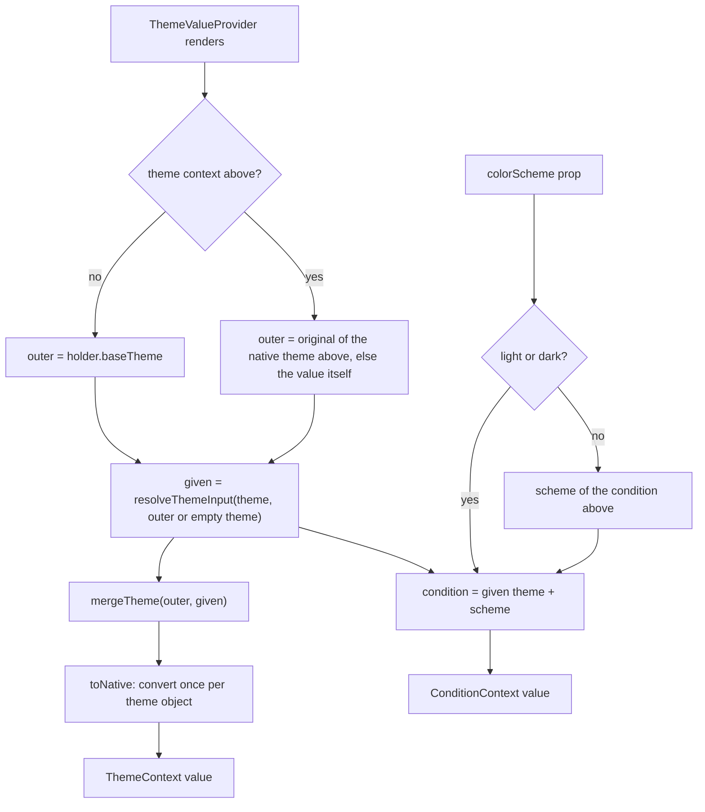

# ThemeValue.tsx

## What it does

`createThemeValue(holder, convert, ThemeContext?)` makes the contexts of one style on React Native and returns
`{ ThemeContext, ThemeValueProvider, useTheme, useCondition }`. The theme context holds the real theme as
React Native takes it (lengths as numbers); a second, private context holds the `NativeCondition` that
`when()` and `whenScheme()` keys are matched against.

## Why it exists

A provider must merge its theme over the one above and also tell styles which theme object and scheme are
nearest. Two things make this fiddly: the theme is converted to native values (`convert`), and a provider
and a function theme must work on the original, unconverted theme so that one source behaves the same on
both platforms. This file keeps the two apart with a pair of weak maps. `createStyle.ts` calls it and wraps
`ThemeValueProvider` as `ThemeProvider`; `createStyle.ts` passes the context in (the default style creates it
early so it can be exported).

## The logic

`useTheme` returns the context value, or `toNative` of the base theme (or an empty theme) with no provider.
`useCondition` returns the context value, or `{ theme: holder.baseTheme, colorScheme: undefined }`.

## The data

- `ThemeHolder<T>` is `{ baseTheme: T | undefined }`: the base theme given by the app (`createStyle(theme)`,
  `configure({ theme })`), never set by a provider.
- `nativeByTheme` (theme -> native theme) and `themeByNative` (native -> original), both `WeakMap`s.
- The condition's `theme` is `given`, the theme as this provider was given it, not the merged one.

## What it guarantees

- A theme object is converted once; the same object always gives the same native object.
- The original of a native theme is recovered through `themeByNative`; a value an app put into the context
  itself is taken as it is.
- `useMemo` keeps `value` and `condition` stable while `theme`, the outer theme and the scheme are unchanged.
- The provider renders no host element, only two context providers.
- `'use client'` is the first line, and nothing runs at module top level.

## Decisions

- A provider merges the original theme and converts the result, instead of merging native themes. The
  comment on `createThemeValue` gives the reason: one source must do the same on both platforms (for a
  function theme, `theme` receives the theme as given).
- `light dark` and no scheme keep the scheme above (`readSchemeName` returns `undefined`).

## Limits

- `ThemeHolder` has the same shape as `NativeHolder` in `createStyle.ts`; the two are declared separately.
