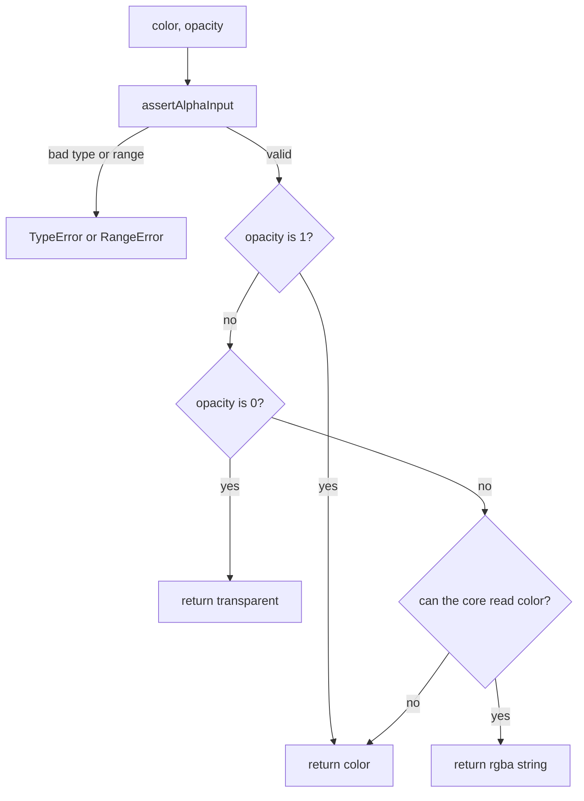

# alpha.ts

## What it does

`alpha(color, opacity)` returns one color string: the color at the given opacity. A literal that the core can
read becomes `rgba(r, g, b, a)`; any other color string comes back unchanged.

## Why it exists

A source that calls `alpha` must run on both platforms. A native style has no CSS variables, so the
function returns a color string a native style takes. The checks and the color reading are the core's (`assertAlphaInput`, `toRgba`), so this file stays at the
decision of what to return. It is re-exported by `index.ts` (`export * from './alpha'`).

## The logic

## What it guarantees

- It throws what the web `alpha` throws: a `TypeError` for a color that is not a string or an opacity that is
  not a number, a `RangeError` for an opacity outside 0 to 1.
- Opacity 1 returns the input string itself; opacity 0 returns `transparent` whatever the color is.
- A color the core cannot read (a named color, for example) is never altered or rejected.

## Decisions

- The two ends (1 and 0) are answered before the color is read, so they work for colors that cannot be read.
- Returning `color` for an unreadable color, not throwing, is in the code; the reason is not recorded.
