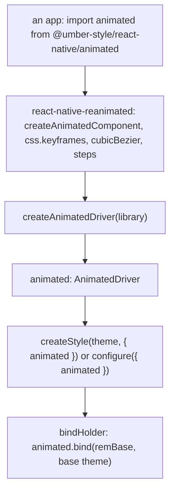

# animated.ts

## What it does

The entry `@umber-style/react-native/animated`. It imports four functions of react-native-reanimated
(`createAnimatedComponent`, `css.keyframes`, `cubicBezier`, `steps`) and exports `animated`, the
`AnimatedDriver` that `createAnimatedDriver` (`animatedDriver.ts`) makes over them. An app passes it on:
`createStyle(theme, { animated })` or `configure({ animated })`.

## Why it exists

The library throws when it is imported where its native part is not built in, so an import of it cannot be
tried and caught by the binding: an app that has the library imports this entry, and an app that does not
never loads it. The binding itself never imports this file (`index.test.ts` walks the imports of
`index.ts` and finds neither this file, nor a `motion*` file, nor the library). The value is passed as an
option, not imported for its side effect: a bundler drops an import done for its side effect under
`"sideEffects": false`.

## The logic

## What it guarantees

- The four functions are the library's public API (`src/index.ts` of 4.8.0 exports
  `createAnimatedComponent` and, through `export * from './css'`, `css`, `cubicBezier` and `steps`).
- `animated` is one value for the program: the animated form of a component is made once, whatever styling
  binds it.
- The library is a peer dependency of the package, optional, with its worklets runtime: `~4.7.0 || ~4.8.0`
  and `~0.13.0 || ~0.14.0`. The four functions are the same in 4.7.1 (`src/index.ts`, `src/css/index.ts` and
  `src/css/easing/index.ts` of both), and the tests passed against 4.7.1 and 0.13.0 as against 4.8.0 and
  0.14.0, the versions the repository keeps. The binding without this entry keeps its
  own range of React Native.

## Decisions

- An entry of its own, not an import of the library that is tried and caught: the import throws at load
  where the native part is missing, and a bundler would include the library in every app either way.
- `createAnimatedComponent` rather than the lighter `createCSSAnimatedComponent`, which the library exports
  too (`src/css/index.ts`, 2): the first is the one its `Animated.View` is made with
  (`src/component/View.ts`, 17-20), so a component of the binding behaves as the library's own views do.

## Limits

- Only the library's official mock ran it, in the tests (`animated.test.tsx`); a device did not.
