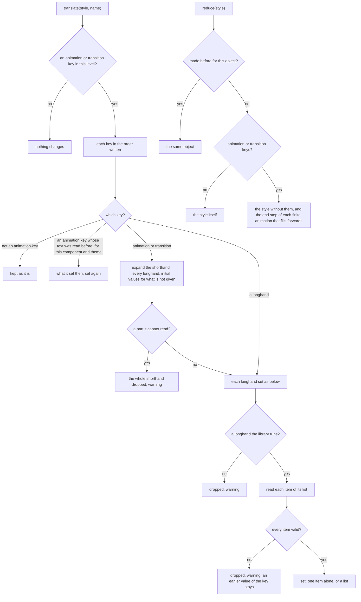

# animatedDriver.ts

## What it does

`createAnimatedDriver(library)` makes the `AnimatedDriver` of the entry over the four functions it takes from
the animation library. `bind({ remBase, readTheme })` makes the `Motion` of one styling, with three members:

- `translate(style, name)` turns, in place, the animation and transition keys of one level of a style into
  what the library takes: the shorthands expanded (`motionShorthand.ts`), a name of `keyframes` turned into a
  rule of the library, times into milliseconds, easings into names or easing objects, keywords checked, and
  the properties of a transition named as the platform names them;
- `reduce(style)` gives the style for a user who asked for less motion;
- `wrap(component)` gives the animated form of a component, made once.

## Why it exists

React Native has no CSS. react-native-reanimated 4.8.0 runs animations and transitions written in the words of
CSS, but it takes them in its own forms, and the shared style is written in the web's. Each row below was read
in the library's source at 4.8.0 (paths are in its package); 4.7.1 has the same files for every row but
the transform (see Limits):

| The web writes                                           | 4.8.0 takes                                                                                                                                                                                                | This file                                                                                                          |
| -------------------------------------------------------- | ---------------------------------------------------------------------------------------------------------------------------------------------------------------------------------------------------------- | ------------------------------------------------------------------------------------------------------------------ |
| `animationName: name`                                    | a keyframes object or a rule of `css.keyframes`; a string is left out without a word (`src/css/utils/props.ts`, 98-118: only a rule or a non-empty object counts, `'none'` stops the animation)            | looks up the steps (`readKeyframesSteps` of the core) and passes one rule for each name, the same object each time |
| `'1.5s'`, `'300ms'`, a number                            | the three: a number is milliseconds; text must match `-?(\d*\.)?\d+ms` or `...s`, lower case, else it throws (`src/css/utils/parsers.ts`, 80-91; `src/css/native/normalization/common/settings.ts`, 24-42) | gives a number of milliseconds, read in any case and with an exponent, and drops a negative duration               |
| a named easing                                           | the seven names of CSS (`src/css/constants/settings.ts`); any other text throws (`.../common/settings.ts`, 44-64)                                                                                          | passes the seven names                                                                                             |
| `'cubic-bezier(...)'`, `'steps(...)'` text in a longhand | throws (`.../common/settings.ts`, 44-64); its `transition` shorthand parses them (`.../transition/shorthand.ts`, 62-115)                                                                                   | parses them by hand (`motionText.ts`) into `cubicBezier(...)` and `steps(...)` of the library                      |
| `transform: 'translateX(10px) rotate(45deg)'` in a step  | text, each value read with `parseFloat`, so `px` is taken off by the library (`src/common/style/processors/transform.ts`, 12-22); an angle needs `deg` or `rad`                                            | passes the text: no `px` needs taking off                                                                          |
| the component                                            | one made by `createAnimatedComponent`; it reads the style of its props as a list, and a function style is not seen (`src/createAnimatedComponent/utils.ts`, 55-71)                                         | wraps the component once, only when its styles animate (`styled.ts`)                                               |

## The logic

`animationName` is read apart: each name of the list that `keyframes` returned becomes the rule of its steps
(`readRule`), `none` is left out, an unknown name is left out with a warning; with nothing left the value is
`'none'`. A rule or an easing object of the library given as it is (a native style written for the library)
is passed as it is.

## The data

- One `Map` from a name to its rule for each `bind`, and for steps that are a function of the theme one such
  map for each theme object (`WeakMap`): the rule is made at the first use of the name.
- For each `bind`, for each base theme, a `Map` from a component, a key and a value written as text or a
  number to what that key sets (`readKeyOnce`): a function style gives the same text on every render, and
  reading it again was most of the cost of a translation (about 19 us for a style with an `animation`
  shorthand before, about 2 us after, in Node on the built file). It holds at most 1000 and is then emptied
  at once. The name of the component is part of the key, so each component still gets its own warning.
- A `WeakMap` from each rule to the steps it was made from, for `reduce`.
- A `WeakMap` from each style to its reduced form, for each `bind`.
- A `WeakMap` from each component to its animated form, for the driver.

## What it guarantees

- One name gives one rule of the library for one styling and one base theme: the library compares a rule by
  identity (`src/css/native/managers/CSSAnimationsManager.ts`, 148-168: a rule is used as it is; an object
  is turned into text and looked up on every update) and registers the steps of a name once, counting the
  views that use them (`src/css/native/keyframes/CSSKeyframesRegistry.ts`, 36-85).
- A value the library would throw for (a negative duration or count, an unknown keyword, an easing it does
  not know, `none` in a list of properties: `src/css/native/normalization/animation/settings.ts`, 36-82;
  `.../transition/config.ts`, 44-64) never reaches it: it is dropped with a development warning that names the component and what to
  write, as the web drops a declaration that is not valid.
- A later key wins over an earlier one of the same level, shorthand or longhand, as in a rule of the web; a
  value that is not valid leaves the value an earlier key gave.
- `reduce` gives the same object for one style each time, and the style itself when it has no animation key.

## Decisions

- Times are given as numbers of milliseconds, not as text: the library's text form is narrower than the
  web's (no upper case, no exponent), and a number is what it computes with.
- The keys in a list are expanded as CSS does: `transitionProperty: 'background-color, opacity'` is
  `['backgroundColor', 'opacity']`, the names the library compares with the keys of the style
  (`src/css/native/managers/CSSTransitionsManager.ts`, 105-124).
- The shorthands are expanded here, not passed: the library runs no `animation` shorthand at all
  (`src/css/utils/props.ts`, 57-59, "TODO - add support for animation shorthand"), and its `transition`
  shorthand throws on a part it cannot read (`src/css/utils/parsers.ts`, 37-77). Expanding both here gives
  one reading for both, with a warning and no exception.
- Reduced motion: the library's CSS path does not ask the system (nothing under `src/css` of 4.8.0, nor under
  `Common/cpp/reanimated/CSS`, reads the setting; only its layout and shared-element animations do,
  `src/ReducedMotion.native.ts`), so `styled.ts` asks through the binding's own state, and `reduce` takes the
  keys away. "No animation" means the view shows its own style; an animation that fills forwards (`forwards`
  or `both`) and ends shows the step it would end on, so that an entrance whose own style is the start does
  not stay at the start. An infinite animation, or one whose count is not whole, shows its own style.
  Transitions are taken away, so a change of style jumps to its end.
- The steps of a function of the theme are resolved against the base theme of the styling (`readTheme`), as
  the web resolves them against the engine's tokens: a provider does not change them.

## Limits

- What the library does with what it is given (its normalization, the native side) was not run: the tests
  use its official mock, whose `createAnimatedComponent` returns the component itself.
- A `'none'` in a list of names is left out, so the lists of the other longhands no longer line up with the
  names by position after it (the library takes a list with `'none'` in it as no animation at all,
  `src/css/utils/props.ts`, 106-112).
- `linear(...)` as text is not read (only `cubic-bezier` and `steps` are): it is dropped with a warning.
- 4.7.1 differs from 4.8.0 on transforms: `none` is not read (`src/common/style/processors/transform.ts`
  of 4.7.1, 180-200; 4.8.0 returns no transform for it, 190-192), and text it cannot read throws, because
  its props builder does not catch the error (`src/common/style/createPropsBuilder.ts` of 4.7.1, 97; 4.8.0
  catches it and warns, 104-110). `motionSteps.ts` checks a transform of a step before the library sees
  it. It also does not animate `borderCurve`, `experimental_backgroundImage`, `verticalAlign`,
  `writingDirection` and `objectFit` (`src/common/style/config.ts` of 4.7.1, 178, 197, 223, 232, 240).
