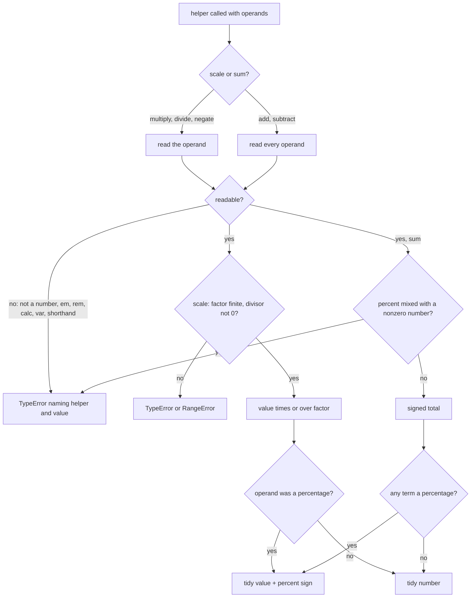

# calc.ts

## What it does

`multiply`, `divide`, `add`, `subtract` and `negate` do arithmetic on style values and return a number, or a
percentage string (`'50%'`). An operand is a number, a numeric string (`'8'`, `'8px'`) or a percentage string.

## Why it exists

React Native has no `calc()` (`warnStyle.ts` warns about one and says "Use add, subtract, multiply and
divide, which return numbers"), so on this platform the helpers compute the result at once. A source that writes
`multiply(theme.space[2], 2)` then runs on both platforms. `index.ts` re-exports the file with
`export * from './calc'`. It reads strings with `readNumber` of `units.ts`.

## The logic

`negate` is `scale(value, -1)`. `tidy` rounds to six decimals and adds `0` so that `-0` becomes `0`.

## The data

An `Operand` is `string | number`; a `Percent` is `` `${number}%` ``. Inside, `read` returns
`{ value, isPercent }`, and a sum is a list of `{ operand, sign }` terms. From the tests:
`multiply(0.1, 3)` is `0.3`, `multiply('50%', 2)` is `'100%'`, `multiply(' -1.5PX ', 2)` is `-3`.

## What it guarantees

- A number in gives a number out; a percentage in gives a percentage out; the overloads say so in types.
- Float noise is rounded off (`0.1 * 3` is `0.3`), and the result is never `-0`.
- A number `0` mixes with percentages in a sum (it is both); any other mix throws a `TypeError`.
- `rem` is refused (`calc.test.ts`: "throws for rem, which it has no base for"): a helper has no `remBase`.
- A non-finite number throws a `RangeError`, a non-number a `TypeError`, a divisor of 0 a `RangeError`.
- The error message names the helper and the value.

## Decisions

- Computing at once instead of building an expression is the platform's constraint (no `calc()`).
- `rem` is refused here, while a style value in `rem` is converted elsewhere with `remBase`. The comment on
  `read` gives the reason: a helper has no base for it. A theme already holds numbers.
- Strings are read with the same reader as style values, so `'8'` and `'8px'` agree with `units.ts`.

## Limits

- No `em`, `calc()`, `var()` or multi-value shorthand operand: all throw a `TypeError` (see `calc.test.ts`).
- No unit other than none, `px` and `%`.
