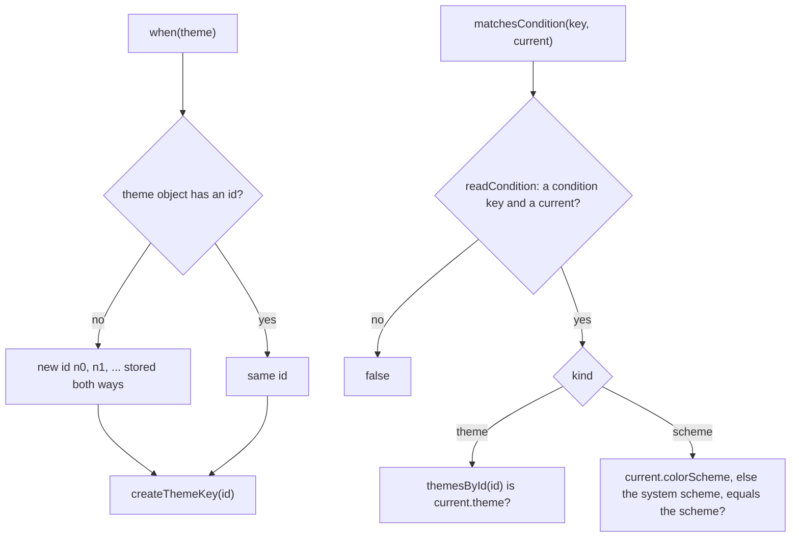

# conditions.ts

## What it does

Decides whether a condition key in a style (`when(theme)` or `whenScheme('dark')`) holds right now. It gives
`when` its key (`createNativeThemeKey`), reads the scheme name a provider was given (`readSchemeName`), and
answers `matchesCondition(key, current)` against the nearest provider's `NativeCondition`.

## Why it exists

On the web a condition becomes a CSS scope or scheme rule that the browser's cascade settles. React Native
has no cascade, so the binding keeps the condition key in the style and compares it at render time against
the theme object and color scheme of the nearest provider. The key syntax and `readCondition` are the
core's; this file adds the native meaning of a theme key: an id that stands for one theme object, compared
by identity. Importers: `ThemeValue.tsx` (`readSchemeName`, `NativeCondition`), `toNativeStyle.ts`
(`matchesCondition`), `createStyle.ts` (`createNativeThemeKey`), `styled.ts` (the type).

## The logic

## The data

`NativeCondition` is `{ theme: object | undefined, colorScheme: SchemeName | undefined }`: the object given to
the nearest provider's `theme` prop (the base theme with no provider) and the scheme of the nearest provider
that has one. The id table is two maps, `themesById` (a `Map`) and `idsByTheme` (a `WeakMap`), with ids
`n0`, `n1`, and so on.

## What it guarantees

- The same theme object always gets the same id, so equal `when(theme)` calls give equal keys.
- The tables are shared state under the name `react-native.theme-ids@1`, so two copies of the binding in one
  program never give one id to two themes (the comment on the declaration says so; `copies.test.tsx`).
- `matchesCondition` returns `false` for a key that is not a condition key, and for no `current`.
- A scheme key with no scheme on the provider falls back to `Appearance.getColorScheme()`.
- `readSchemeName` maps anything but `'light'` or `'dark'` (`light dark`, nothing) to `undefined`.

## Decisions

- The theme is matched by identity of the object given to `ThemeProvider`, not by its contents.
  `ThemeValue.tsx` stores that given object (not the merged one) in the condition for this reason.
- Ids are counted (`n` plus the table size), which is why the tables must be shared between copies.

## Limits

- `themesById` is a `Map` that holds each theme object for the life of the program (not weak), so an object
  passed to `when` is never freed. The code shows it; no reason is recorded.
- The `colorScheme` argument of `when` is not used on this platform (`types.ts`).
