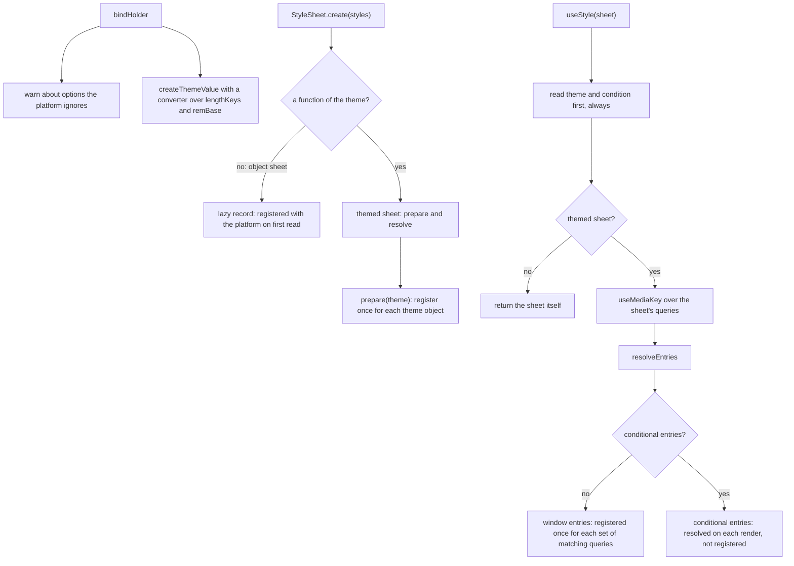

# createStyle.ts

## What it does

`bindHolder(holder, context?, options?)` builds the whole React Native styling of one theme shape: `styled`,
`StyleSheet`, `useStyle`, `apply`, `css`, `ThemeProvider`, `useTheme`, `when`, `whenScheme` and the web
members that do nothing here. `createStyle(theme, options)` is `bindHolder` over a holder of that theme.

## Why it exists

The default style (`defaultStyle.ts`) and an app's own style (`createStyle`) must be the same code over
different holders of the base theme. This file wires the pieces (`ThemeValue.tsx`, `styled.ts`,
`toNativeStyle.ts`, `windowState.ts`, `nativeTheme.ts`) into the `NativeStyle<T>` interface of `types.ts`.
It also owns sheets: registering a sheet's entries with the platform and resolving them for conditions and
the window. Importers: `defaultStyle.ts` (`bindHolder`) and `index.ts` (`createStyle`).

## The logic

## The data

`RegisteredSheet` holds `entries` (as registered with the platform StyleSheet), `source` (the styles before
conversion), `keys` (a `StyleKeys` for each entry), `isConditional`, `queries`, `hasScheme` and a lazy
`byWindow` map from a window key to entries. The holder is a `ThemeHolder<T>` of `ThemeValue.tsx`,
`{ baseTheme }`: `createStyle` makes one with its theme, `defaultStyle.ts` one that `configure` fills.

## What it guarantees

- A function sheet is registered once for each native theme object (`WeakMap`), not on each render.
- An object sheet registers on first read of a key, once, with no theme and no condition; it is its own
  registered styles and `useStyle` returns it unchanged.
- The hooks of a component never change between renders: the contexts and the window key are read first,
  for every sheet.
- Entries that depend only on the window are registered once for each set of matching queries; entries with
  a `when()` or `whenScheme()` key are resolved on each render and never registered.
- `css()` merges its styles in order, last key wins, drops falsy values and flattens lists; a function or a
  non-object throws a `TypeError`.
- `Global`, `ThemeScope`, `useThemeClass`, `themeClass` do nothing (`Global` renders `null`, `ThemeScope` its
  children, `themeClass` returns `''`, `useThemeClass` `undefined`); `keyframes` and `globalStyles` come from
  the core so one source runs on both.
- `apply(...entries)` returns `{ style: [...] }` with falsy entries removed.

## Decisions

- Registered styles go through the platform's `StyleSheet.create` after `toNativeStyle` removed web-only keys.
- Warnings name the entry (`sheet entry "key"`) or `css()`.
- The scheme is watched only when a sheet has a `whenScheme()` key and no provider gives a scheme
  (`shouldWatchScheme`).
- `resolve(theme, condition)` of a sheet reads the key with `hasScheme` false; it is for direct calls, and
  `useStyle` is the path that watches the scheme.

## Limits

- Only `remBase` and `lengthKeys` of the options are used; the rest warn in development.
